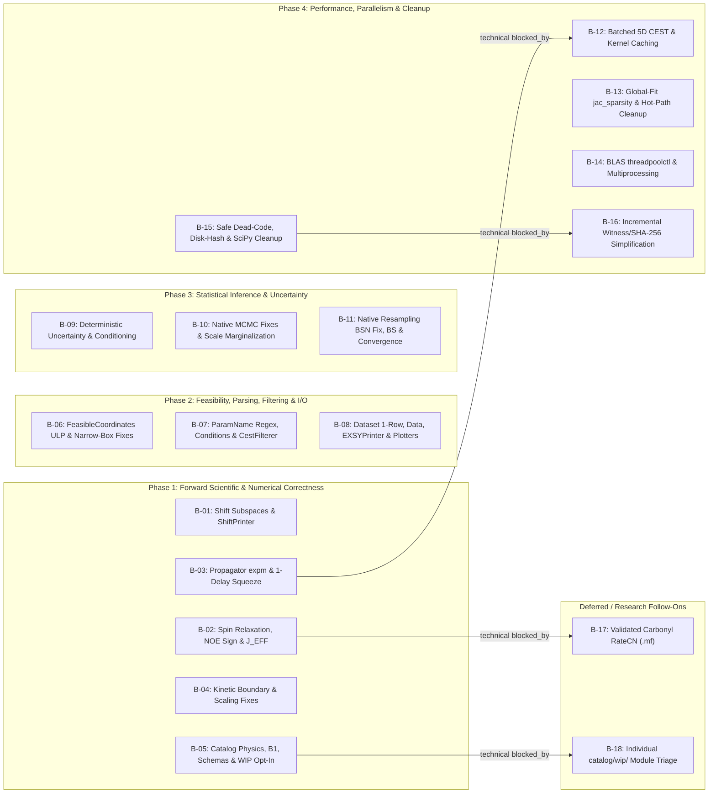

# Post-Audit Investigation & Improvement Roadmap

> [!NOTE]
> **Status**: Maintainer-aligned backlog specification published to GitHub Issues (2026-11-14) — **no production code has been modified**.
> - **Source Audit**: [2026-11-independent-codebase-review.md](2026-11-independent-codebase-review.md) (preserved intact; anchored to `main` at commit `d0ba6e34`, `v2026.09.2`).
> - **Tracker Snapshot Checked**: `gbouvignies/ChemEx` GitHub Issues, Pull Requests, [CONTEXT.md](../../CONTEXT.md), and `docs/adr/0001`–`0007`.
> - **Published GitHub Issues**: Parent tracking issue [#800](https://github.com/gbouvignies/ChemEx/issues/800) linking **`B-01`–`B-18` as native GitHub sub-issues [#801](https://github.com/gbouvignies/ChemEx/issues/801)–[#818](https://github.com/gbouvignies/ChemEx/issues/818)** (`B-XX` maps 1-to-1 to `#8XX`), with native `blocked_by` edges restricted strictly to genuine technical dependencies (`#803` → `#812`, `#815` → `#816`, `#802` → `#817`, `#805` → `#818`).

---

## 1. Cross-Check Against Existing Codebase Contracts, Issues, PRs, and ADRs

Before finalizing the backlog items, open/closed GitHub issues, pull requests, Architecture Decision Records, and parameter-compilation internals were checked to prevent duplicate work, filter out false positives, and preserve settled design choices.

### 1.1 Active In-Flight Work (Branch De-confliction Note)
- **Open Issue `#795` / Open PR `#796` (*Improve fit starting values and retire SEARCH.DE*)**:
  - **Overlap**: Deletes `src/chemex/optimize/de_direct_trf.py` (-1,321 LOC), adds `[STEP.SEARCH.PREPARE]` (`src/chemex/optimize/profile_preparation.py`), and touches `direct_trf.py`, `profiled_grid.py`, `native_deterministic.py`, and `method_compiler.py`.
  - **Impact**:
    1. Audit observations about `de_direct_trf.py` (`workers = 1` in DE search) are superseded once `#796` merges.
    2. Sub-issues touching `direct_trf.py` or `profiled_grid.py` (`B-06`, `B-13`, `B-14`, `B-15`, `B-16`) carry a branch-coordination note against `#796` rather than a hard GitHub `blocked_by` edge.
- **Open Dependabot PRs (`#784`, `#797`, `#798`, `#799`)**: Routine dependency updates; only `B-15`'s `pyproject.toml` `uv_build`/`scipy` range edits overlap marginally.

### 1.2 Post-Audit Validation & Settled Historical Decisions

1. **`4st_hd` Detailed Balance in Production — Validated Non-Defect (`factory.py:329-334`)**:
   - Audit `1.4.1` noted that standalone evaluation of `settings_4st_hd` ([settings_4st_hd.py](../../src/chemex/models/kinetic/settings_4st_hd.py#L92-L138)) with `phi_b != phi_a` violates cycle detailed balance ($K p \neq 0$).
   - Post-audit inspection of `ParameterFactory.create_parameters` ([factory.py](../../src/chemex/parameters/factory.py#L329-L334)) confirmed that ChemEx automatically seals every kinetic parameter carrying a non-empty default `expr` as `model_owned=True`. Because `phi_b` is declared with `expr="{phi_a}"`, users cannot override or independently fit `phi_b` in production (`phi_b == phi_a` holds identically), so `4st_hd` already satisfies exact microscopic reversibility and stationary equilibrium ($K p = 0$, covered by [test_audited_model_repairs.py](../../tests/models/kinetic/test_audited_model_repairs.py#L244-L311)).
   - **Disposition**: Reclassified as **Validated Non-Defect in Production** (removed from `B-04`; documented in the traceability matrix).

2. **`DERIVED` Parameter Bounds at Commit — Settled by Design (Closed Issue `#700`)**:
   - Audit `1.7` noted that `DERIVED` parameter `[min, max]` bounds are not enforced at `AnalysisValues.commit()` ([parameterization.py](../../src/chemex/parameters/parameterization.py#L884-L895)).
   - **Issue `#700`** (*Do not apply configured bounds as implicit domains to derived parameter values*) established that configured bounds constrain independent numerical coordinates, whereas expression-derived values may legitimately take finite values outside default configuration bounds.
   - **Disposition**: **Settled (`#700` — No Action)**. Do not re-introduce generic bound rejection on `DERIVED` values at commit.

3. **Interior Near-Boundary Covariance Reporting — Preserving Issue `#675` & ADR-0004**:
   - **Issue `#675`** and [ADR-0004](../adr/0004-make-deterministic-uncertainty-authoritative.md) deliberately publish curvature-derived standard errors for interior estimates within $3\sigma$ of a bound ($\zeta \le 3$) with `boundary may make local error asymmetric`.
   - **Disposition**: Preserved in `B-09` for interior parameters near boundaries, while investigating statistically valid handling for parameters **pinned directly on active bounds**, rank-deficient local residue blocks in global fits, and extreme Jacobian ill-conditioning.

4. **Modal Complete-$B_1$-Dephasing Limit — Preserving Issue `#715` / PR `#793` (`f255bac8`)**:
   - **Issue `#715` / PR `#793`** intentionally defined `dephasing=True` ([propagators.py](../../src/chemex/nmr/_pulses/propagators.py#L48-L56)) as a modal projection removing oscillatory modes ($|\operatorname{Im}\lambda| \ge 10^{-6}$).
   - **Disposition**: Preserved intact in `B-03`; standard `dephasing=False` propagation is hardened via `scipy.linalg.expm` and eigenvector conditioning guards.

5. **Alignment with `ADR-0001`, `ADR-0003`, `ADR-0005`, `ADR-0006`, and `ADR-0007`**:
   - [ADR-0001](../adr/0001-deepen-experiment-type-construction.md): Keep **Experiment Type** composition authoritative (`B-05`).
   - [ADR-0003](../adr/0003-make-specialized-statistical-results-authoritative.md): Keep Resampling and MCMC **Analysis Results** distinct and delete superseded summary stacks (`B-10`, `B-11`, `B-15`).
   - [ADR-0004](../adr/0004-make-deterministic-uncertainty-authoritative.md): Avoid introducing new witnesses, content hashes, serialization contracts, or dual implementations (`B-15`, `B-16`).
   - [ADR-0005](../adr/0005-translate-exceptions-at-the-cli-boundary.md): Raise domain-meaningful `ChemExError` subclasses (`Known ChemEx Failure`) rather than raw runtime errors on invalid user/model configurations (`B-02`, `B-04`, `B-05`).
   - [ADR-0006](../adr/0006-make-generic-nstate-domain-authoritative.md): Preserve exact **Population Simplex** boundaries without softmax or arbitrary interior clipping (`B-04`, `B-06`).
   - [ADR-0007](../adr/0007-compile-method-plans-into-executable-steps.md): Preserve step-time observation mask recalculation across **Method Steps** (`B-07`).

---

## 2. Maintainer Policy Decisions Resolved (`/grill-me` Summary)

All cross-cutting design, scientific, statistical, packaging, and tracking choices were resolved prior to issue creation:

| Topic | Aligned Decision |
| :--- | :--- |
| **GitHub Tracker Layout** | Single parent tracking issue (no `wayfinder:map` label) with **18 native GitHub sub-issues (`B-01`–`B-18`)**. Use native `blocked_by` edges **only for genuine technical dependencies** (`4` edges total) so independent work can proceed in parallel. Publish the complete backlog upfront while keeping freedom to refine, split, or close items later. |
| **`ShiftPrinter` Output (`B-01`)** | Make `ShiftPrinter` unit-aware: `# Unit: PPM` with `.6f` precision for `shift_15n_sq` and `shift_13c_sq`; `# Unit: PPB` with `.3f` precision for `shift_15n_sqmq`; respect `simulation=True` consistently with other ChemEx printers; document user-visible format changes in `CHANGELOG.md`. |
| **Carbonyl `"cn"` `.mf` (`B-02`, `B-17`)** | Explicitly reject `.mf` for `"cn"` / `"cn_d"` (`cpmg_13co_ap`) with a clear `Known ChemEx Failure` now (preserving independent relaxation rates). Track a scientifically validated `RateCN` model (including $^{13}\text{C}'\text{–}{}^{13}\text{C}^\alpha$, nearby $^{1}\text{H}$ dipolar, and rhombic carbonyl CSA interactions) separately in **`B-17`**. |
| **Non-`.mf` `r2a` Defaults (`B-02`)** | Before changing `spins.py` defaults (`{r2_i} - {r1_s}`), investigate the physical Redfield justification across `"ch"`, `"hc"`, `"cn"`, and deuterated variants (`rates.py:113-163`), accounting for direct $IS$ dipolar terms vs passive-spin $R_1$. Implement scientifically justified corrections with regression tests and document any numerical/fit changes. |
| **WIP Catalog Modules (`B-05`, `B-18`)** | Exclude `catalog/wip/` from production auto-registration by default while keeping a simple explicit opt-in for R&D/testing (verifying no shipped examples/tests break and raising a clear diagnostic when requested without opt-in). Record individual `wip/` module defects in **`B-18`** for triage when those experiments become relevant. |
| **Deterministic Uncertainty (`B-09`)** | Preserve `#675` / `ADR-0004` for interior near-boundary estimates. Investigate isolating rank-deficient local residue blocks (accounting for global-parameter coupling), appropriate constrained uncertainty methods at active bounds (without assuming naive coordinate projection is valid), and non-arbitrary conditioning diagnostics so unreliable covariances are never silently reported as trustworthy. |
| **Native MCMC (`B-10`)** | Fix the four confirmed implementation defects immediately (post-burn-in ESS, scale-aware interior walker init, relaxation PSD check, `DERIVED` posterior summaries). Treat profile-likelihood vs marginalized-likelihood as a **statistical modeling decision** (not a confirmed defect): establish the intended Bayesian generative model—including the prior and admissible domain of the per-profile scale factors ($s_g$)—before proposing any change to `_LogDensityKernel`, adopting the more principled statistical model if justified. |
| **Native Resampling (`B-11`)** | Fix the `bsn` omitted-residue spike immediately. Preserve the current `bs` definition on singleton reference pools (`len == 1`) with a clear limitation warning while investigating validated alternatives separately. Report attempted/successful/failed replicate counts, distinguish optimizer failures from scientifically invalid samples, and verify no survivorship/selection bias before relaxing the 100% convergence gate. |
| **SciPy Version Pin (`B-15`)** | Remove the runtime `(major, minor) == (1, 18)` lock in `direct_trf.py` and relax `pyproject.toml` to `scipy>=1.18`, relying on `uv.lock` and CI regression suites to qualify new SciPy releases. |
| **Phase 4 Cleanup & Ceremony (`B-14`–`B-16`)** | Split into three focused sub-issues: **`B-14`** (BLAS `threadpoolctl` & multiprocessing), **`B-15`** (immediate safe cleanup of ~1,635 LOC dead summary stacks, `inspect.getsource()` disk hashing, mutable spin-system cache, and `scipy`/`uv_build` pins), and **`B-16`** (incremental pruning of single-process witness/SHA-256/`__post_init__` replay ceremony). |

---

## 3. Evidence Classification & Technical Dependency Graph

### Evidence Classes
- **`[Defect — Demonstrated]`**: Confirmed in code and/or empirical reproduction; causes wrong scientific observables, corrupted output files, silent drops of user configuration, or crashes on valid inputs.
- **`[Investigation + Fix — Scientific / Statistical]`**: Confirmed limitation or suspected defect where empirical/theoretical validation is part of the sub-issue contract before changing established numerical or statistical behavior.
- **`[Statistical Modeling Decision]`**: Open methodological question (not a confirmed implementation bug) requiring definition of the intended probabilistic model, priors, and parameter domains before deciding whether to change the statistical formulation.
- **`[Bottleneck — Verified]`**: Demonstrated algorithmic or concurrency bottleneck ($O(P^3)$ pure-Python loops, dense uncolored global-fit FD Jacobians, unbatched per-offset LAPACK calls, post-import `os.environ` BLAS thread control).
- **`[Architecture / Maintainability]`**: Dead code (~1,635 LOC), runtime `.py` source-file hashing, shared mutable cache entries, dependency range locks, and single-process witness/Merkle ceremony.

### Technical Dependency Graph (`blocked_by` Edges Only)

Per maintainer policy, `blocked_by` edges exist **only** where one sub-issue depends directly on code or contracts established by another (`14` of `18` sub-issues are completely unblocked):



---

## 4. Sub-Issue Specifications (`B-01`–`B-18` / `#801`–`#818`)

Conventions follow [issue-tracker.md](../agents/issue-tracker.md), [triage-labels.md](../agents/triage-labels.md), and [CONTEXT.md](../../CONTEXT.md). Every sub-issue `B-01` through `B-18` corresponds directly to GitHub issue `#801` through `#818` under parent tracking issue [#800](https://github.com/gbouvignies/ChemEx/issues/800).

---

### Phase 1 — Forward Scientific & Numerical Correctness

#### `B-01`: Fix chemical-shift calculation in complex coherence subspaces and make `ShiftPrinter` unit/simulation-aware
- **Proposed Labels**: `bug`, `ready-for-agent`
- **Evidence Class**: `[Defect — Demonstrated]`
- **Technical `blocked_by`**: None.
- **Supporting Audit Findings**:
  - [Audit 1.1](2026-11-independent-codebase-review.md#11-confirmed-defect-chemical-shift-experiments-select-conjugate-ghost-eigenvalues-and-pool-coherence-subspaces-producing-silent-00-ppb-or-inverted-shifts): `SpectrometerAnalysis.calculate_shifts()` ([analysis.py](../../src/chemex/nmr/_engine/analysis.py#L19-L25)) takes `eigvals(liouv).imag` of a real Cartesian Liouvillian (`±ω` conjugate pairs) and matches eigenvalues by proximity to `cs_a * ppm` in [shift_15n_sqmq.py](../../src/chemex/experiments/catalog/shift_15n_sqmq.py#L37-L86), [shift_15n_sq.py](../../src/chemex/experiments/catalog/shift_15n_sq.py#L70-L74), and [shift_13c_sq.py](../../src/chemex/experiments/catalog/shift_13c_sq.py#L70-L74).
  - [Audit 1.7e (Printers)](2026-11-independent-codebase-review.md#17-confirmed-defect-parameter-parsing-filtering-kinetic-edge-case-distribution-io--plotting-bugs): `ShiftPrinter` ([printers/data.py](../../src/chemex/printers/data.py#L17-L35)) hardcodes `# Unit: PPB`, formats all values with `17.3f` (truncating `ppm` shifts/errors in `shift_15n_sq` and `shift_13c_sq` to `0.001` ppm = `1` ppb), and ignores `simulation=True`.
- **Scientific & Practical Impact**: **Critical**. `shift_15n_sqmq` silently returns `0.0` ppb whenever `CS_A` is omitted (default `0.0`), flips DQ sign by >200 ppb for Glycine-like shifts near $\delta_H \approx 0.10133\,\delta_N$ ($\omega_{\text{DQ}} \approx 0$), `shift_13c_sq`/`shift_15n_sq` bounce sign across `0.0` ppm, and `ShiftPrinter` mislabels units and truncates `ppm` output precision.
- **Implementation & Validation Scope**:
  1. Construct dedicated $N_{\text{states}} \times N_{\text{states}}$ complex scalar coherence sub-Liouvillians ($I_+$, $I_+S_+$ DQ, $I_+S_-$ ZQ, or signed coherence-order projections) so each coherence pathway has exactly $N_{\text{states}}$ eigenvalues with no conjugate ghosts and no cross-subspace collisions even when `cs_i_a = cs_s_a = 0.0`.
  2. Select the observed-state-connected eigenmode cleanly and validate across slow, intermediate, and fast exchange, `CS_A = 0.0`, methyls near `0` ppm, and Glycine amides near $\omega_{\text{DQ}} = 0$.
  3. Make `ShiftPrinter` unit-aware: `# Unit: PPM` with `.6f` precision for `shift_15n_sq` and `shift_13c_sq`, and `# Unit: PPB` with `.3f` precision for `shift_15n_sqmq`; support `simulation=True` consistently with `ProfilePrinter` (omitting experimental columns in simulation output without unnecessary structural changes).
  4. Add focused regression tests covering shift physics, units, numerical precision, and simulation output (`tests/nmr/`, `tests/printers/`, `examples/Combinations/Shifts/`), and document the user-visible printer format fix in `CHANGELOG.md`.

---

#### `B-02`: Fix spin-relaxation defects (`SIGNED_XI_RATIO` NOE sign, reject `"cn"` `.mf`, aromatic `J_EFF`) and investigate non-`.mf` `r2a` defaults
- **Proposed Labels**: `bug`, `ready-for-agent`
- **Evidence Class**: `[Defect — Demonstrated]` + `[Investigation + Fix — Scientific / Statistical]`
- **Technical `blocked_by`**: None.
- **Supporting Audit Findings**:
  - [Audit 1.5.1](2026-11-independent-codebase-review.md#15-confirmed-defect-unsigned-xi_ratio-inverting-15textn-heteronuclear-noe-sign-aliphatic-ratech-mapped-to-carbonyl-cn-and-missing-aromatic-multiplets): `build_equilibrium_magnetization` ([magnetization.py](../../src/chemex/nmr/_engine/magnetization.py#L48)) uses unsigned `XI_RATIO` instead of `SIGNED_XI_RATIO` ([constants.py](../../src/chemex/nmr/constants.py#L34-L36)), inverting heteronuclear `sigma_is` cross-relaxation (`15N{1H}` steady-state NOE `+1.168` instead of `+0.832`).
  - [Audit 1.5.2](2026-11-independent-codebase-review.md#15-confirmed-defect-unsigned-xi_ratio-inverting-15textn-heteronuclear-noe-sign-aliphatic-ratech-mapped-to-carbonyl-cn-and-missing-aromatic-multiplets): [rates.py](../../src/chemex/nmr/rates.py#L306-L307) silently maps `"cn"` and `"cn_d"` (`cpmg_13co_ap` `.mf`) to aliphatic `RateCH()` / `RateCHDeuterated()`; docstrings (`lines 28, 79, 197`) state `tauc` in seconds rather than nanoseconds.
  - [Audit 1.5.3](2026-11-independent-codebase-review.md#15-confirmed-defect-unsigned-xi_ratio-inverting-15textn-heteronuclear-noe-sign-aliphatic-ratech-mapped-to-carbonyl-cn-and-missing-aromatic-multiplets): [constants.py](../../src/chemex/nmr/constants.py#L82-L266) omits aromatic carbons (`cg, cd1, cd2, ce1, ce2, cz, ch2`) from `J_EFF["f","y","w"]` and `"n"` from `J_EFF["u"]`, and returns unnormalized weights (`sum == 2**n_J`) from `get_multiplet`.
  - [Audit 1.2](2026-11-independent-codebase-review.md#12-confirmed-defect-inverted-sign-in-anti-phase-13textc-relaxation-constraint-r2a_i--r2_i---r1_s-across-all-non-model-free-spin_systemch-experiments): [spins.py](../../src/chemex/parameters/spins.py#L24-L38) and [spins.py](../../src/chemex/parameters/spins.py#L155-L197) set base non-`.mf` defaults `r2a_i = {r2_i} - {r1_s}` and `r2a_s = {r2_s} - {r1_i}` and handle `r1a_is.expr` asymmetrically between `"nh"` and `"hn"`.
- **Scientific & Practical Impact**: **High**. Restores physically signed heteronuclear NOE cross-relaxation, stops silent aliphatic relaxation calculations on carbonyl `.mf` fits, fixes aromatic $^{13}\text{C}$ CEST `KeyError` crashes and unnormalized multiplet weights, and rigorously audits non-`.mf` anti-phase relaxation constraints.
- **Implementation & Validation Scope**:
  1. Switch two-spin thermal equilibrium polarization in `magnetization.py` to `SIGNED_XI_RATIO`, verifying `build_start_magnetization` and detection conventions across all `*_eq` **Experiment Types** so observable profile signs remain consistent.
  2. Remove the silent `RateCH` alias for `"cn"` and `"cn_d"` in `rates.py` and reject `.mf` on `"cn"` spin systems with a clear `Known ChemEx Failure` while preserving independently specified relaxation rates (validated carbonyl `.mf` relaxation is tracked separately in `B-17`); fix `tauc` docstring units (`ns`).
  3. Add aromatic `J_EFF` entries for Phe/Tyr/Trp (and `"n"` for Sec/`"u"`) and normalize `get_multiplet` weights to sum to `1.0`.
  4. **Focused Scientific Investigation (`spins.py` non-`.mf` `r2a` / `r1a_is` defaults)**: Compare `spins.py` expressions against the Redfield relaxation equations in `RatesIS` (`rates.py:113-163`, where $R_{2a,I} - R_{2,I} = R_{1,S} - d_{IS}^2(6 J_S + J_{I-S} + 6 J_{I+S})$) across protonated and deuterated `"nh"`, `"hn"`, `"ch"`, `"hc"`, and `"cn"` spin systems. Establish which non-`.mf` approximation is physically justified for each spin system; if the current minus sign or `"hn"`/`"nh"` asymmetry is confirmed incorrect, implement the correction with scientific regression tests and document any changes to calculated intensities and existing fits in `CHANGELOG.md`.

---

#### `B-03`: Harden Liouvillian propagator calculation at Jordan blocks and fix 1-delay tensor squeezing
- **Proposed Labels**: `bug`, `ready-for-agent`
- **Evidence Class**: `[Defect — Demonstrated]`
- **Technical `blocked_by`**: None.
- **Supporting Audit Findings**:
  - [Audit 1.3](2026-11-independent-codebase-review.md#13-confirmed-defect-propagator-calculation-nplinalgeig--nplinalgsolve-has-dead-expm-fast-path-and-silently-drops-secular-exchange-terms-or-crashes-at-jordan-blocks): `calculate_propagators` ([propagators.py](../../src/chemex/nmr/_pulses/propagators.py#L33-L73)) has a dead `liouv_array.ndim == 2` check (`line 43`), uses `np.linalg.eig` + `np.linalg.solve` unconditionally (silently zeroing secular off-diagonal transfer $t N e^{\lambda t}$ or raising `LinAlgError` -> `IMPLEMENTATION_FAILURE` at Bloch-McConnell exceptional points), and squeezes axis 0 via `if propagators.shape[0] == 1:` (`line 69`) instead of checking scalar `delays`, breaking 1-element delay sequences when `n_jeff > 1` or `n_b1 > 1`. Also inspect `calculate_r1rho` ([analysis.py](../../src/chemex/nmr/_engine/analysis.py#L27-L44)) on `*_eq` bases.
- **Scientific & Practical Impact**: **High**. Eliminates silent 100% off-diagonal propagator errors and solver crashes at coalescence / $p_b = 0$ degenerate-relaxation boundaries, fixes 1-point relaxation/CPMG crashes under $B_1$/$J_{\text{eff}}$ distributions, and provides the batched `expm` foundation required by `B-12`.
- **Implementation & Validation Scope**:
  1. For `dephasing=False` and scalar/1-delay calls (including 4D/5D batched Liouvillians), compute `scipy.linalg.expm(liouv_array * delay)` directly.
  2. For multi-delay calls (`delays_array.size > 1`, `dephasing=False`), either evaluate batched `expm(np.multiply.outer(delays_array, liouv_array))` when `delays_array.size` is small or guard `eig` + `solve` with eigenvector conditioning (`np.linalg.cond(eigenvectors)`) and `LinAlgError` fallback to `expm`.
  3. Preserve Issue `#715` / PR `#793` (`f255bac8`) modal dephasing semantics when `dephasing=True` (`tests/nmr/test_dephasing_shipped.py`, `tests/nmr/test_propagators.py`).
  4. Replace `if propagators.shape[0] == 1:` with scalar-input detection (`np.ndim(delays) == 0`) and verify all `Spectrometer.delays` callers and `calculate_r1rho`.

---

#### `B-04`: Fix kinetic model boundary & scaling defects (`pop_4st`, `3st_monomer_dimer_trimer`, `_oligomerization`, `_eyring`, `nst`)
- **Proposed Labels**: `bug`, `ready-for-agent`
- **Evidence Class**: `[Defect — Demonstrated]`
- **Technical `blocked_by`**: None.
- **Supporting Audit Findings**:
  - [Audit 1.7d (Kinetics)](2026-11-independent-codebase-review.md#17-confirmed-defect-parameter-parsing-filtering-kinetic-edge-case-distribution-io--plotting-bugs):
    1. `pop_4st` ([constraints.py](../../src/chemex/models/constraints.py#L97-L98)) tests `np.isclose(np.linalg.det(mat), 0.0)` (`atol=1e-8`) without rate scaling, collapsing populations to `pa=1, pb=pc=pd=0` for slow exchange rates $k \lesssim 10^{-3}\text{ s}^{-1}$ (because $\det(K_{3\times 3}) \propto k^3 \sim 10^{-9}$).
    2. `settings_3st_monomer_dimer_trimer` ([settings_3st_monomer_dimer_trimer.py](../../src/chemex/models/kinetic/settings_3st_monomer_dimer_trimer.py#L89-L95)) uses unchecked `scipy.optimize.root` instead of bracketed scalar log-monomer root finding (`_oligomerization.py`) and spells `"concetrations"` (`lines 181-236`).
    3. Subnormal `p_total` raises uncaught `RuntimeError` in [_oligomerization.py](../../src/chemex/models/kinetic/_oligomerization.py#L259); benign IEEE-754 underflow of analytical population derivatives (`population * coupling`) raises `ValueError` instead of returning `0.0` in [_eyring.py](../../src/chemex/models/kinetic/_eyring.py#L330-L366); and [settings_nst.py](../../src/chemex/models/kinetic/settings_nst.py#L125-L160) raises raw `ValueError` during corner/derivative evaluation at `(pb=0, pc=0)`.
- **Scientific & Practical Impact**: **High**. Fixes catastrophic population collapse in slow 4-state exchange (HDX/EXSY) and prevents spurious optimizer/uncertainty crashes on extreme concentration, Eyring, and `nst` simplex boundaries.
- **Implementation & Validation Scope**:
  1. Replace unscaled `det(mat)` checks in `pop_4st` (and audit `pop_3st`) with scale-invariant rank/SVD or rate-normalized solving, verifying slow-exchange invariance down to $k \sim 10^{-8}\text{ s}^{-1}$ and disconnected-graph fallback behavior.
  2. Migrate `settings_3st_monomer_dimer_trimer` onto validated bracketed 1D log-monomer equilibrium solving consistent with `_oligomerization.py` while preserving all public parameter names/IDs.
  3. Return `0.0` on benign binary64 underflow of `_population_partial` in `_eyring.py` (when populations themselves are valid), and ensure boundary/domain failures in `_oligomerization.py` and `settings_nst.py` conform to [ADR-0005](../adr/0005-translate-exceptions-at-the-cli-boundary.md) and [ADR-0006](../adr/0006-make-generic-nstate-domain-authoritative.md).

---

#### `B-05`: Fix catalog experiment physics (`1H` IP-AP thermal bath, `coscest_13c`), $B_1$ distributions, `carrier` schemas, CPMG duty-cycle checks, and isolate `catalog/wip/`
- **Proposed Labels**: `bug`, `ready-for-agent`
- **Evidence Class**: `[Defect — Demonstrated]`
- **Technical `blocked_by`**: None.
- **Supporting Audit Findings**:
  - [Audit 1.4.2](2026-11-independent-codebase-review.md#14-confirmed-defect-broken-detailed-balance--non-stationary-initial-state-in-4st_hd-and-broken-thermal-bath-when-start_state-is-set-in-1texth-ip-ap-cest): `start_terms` calls `get_start_terms("ie")` in [cest_1hn_ip_ap.py](../../src/chemex/experiments/catalog/cest_1hn_ip_ap.py#L40-L45), [coscest_1hn_ip_ap.py](../../src/chemex/experiments/catalog/coscest_1hn_ip_ap.py#L45-L49), and [cest_ch3_1h_ip_ap.py](../../src/chemex/experiments/catalog/cest_ch3_1h_ip_ap.py#L38-L42), zeroing `ie_b` when `start_state = "a"`; [coscest_13c.py](../../src/chemex/experiments/catalog/coscest_13c.py#L41-L45) ignores `start_terms` on line 145; `dcest_15n`, `dcest_13c`, and `coscest_13c` compute `d_eq` before resetting `spectrometer.offset_i = 0.0`.
  - [Audit 1.7c ($B_1$ distributions)](2026-11-independent-codebase-review.md#17-confirmed-defect-parameter-parsing-filtering-kinetic-edge-case-distribution-io--plotting-bugs): Broken skewness-to-$\delta$ mapping and `|skewness| == 2.0` jump in [skewed.py](../../src/chemex/nmr/distributions/skewed.py#L83-L156); slant $\alpha$ vs skewness mismatch and broken dead `_owens_t_approx` in [truncated_skewed.py](../../src/chemex/nmr/distributions/truncated_skewed.py#L48-L96); negative $B_1$ quadrature points permitted for large `scale` in `gaussian.py`, `hermite.py`, and `truncated_skewed.py`.
  - [Audit 1.7f (Catalog schemas, CPMG & `wip`)](2026-11-independent-codebase-review.md#17-confirmed-defect-parameter-parsing-filtering-kinetic-edge-case-distribution-io--plotting-bugs): 23 catalog modules type `carrier` / `carrier_dec` as `Frequency` (*"in Hz"*) instead of `ChemicalShift` (*"in ppm"*); CPMG `_get_delays` lack `tau_cp >= 0` duty-cycle checks; supported [cpmg_hn_dq_zq.py](../../src/chemex/experiments/catalog/cpmg_hn_dq_zq.py#L115) crashes on ref-only `max(ncycs_no_ref)` (also check its pulse-width subtraction); [engine.py](../../src/chemex/nmr/_engine/engine.py#L170) silently zeroes offsets if `ppm_i == 0.0`; and [loader.py](../../src/chemex/experiments/loader.py#L42-L45) auto-registers `catalog/wip/` in production builds.
- **Scientific & Practical Impact**: **Medium–High**. Fixes non-equilibrium thermal-bath leakage when `start_state` is used in $^1\text{H}$ IP-AP CEST, fixes discontinuous $B_1$ skewness parameterization, prevents Hz-vs-ppm carrier misconfiguration and negative CPMG delays, and cleanly separates unsupported WIP modules from production ChemEx.
- **Implementation & Validation Scope**:
  1. Populate `ie` across all states at equilibrium in `*_ip_ap` $^1\text{H}$ CEST sequences while applying `start_state` only to initial `iz` polarization; wire `start_terms` in `coscest_13c`; reset `spectrometer.offset_i = 0.0` before `d_eq`.
  2. Replace the ad-hoc skewness conversion in `skewed.py` with the exact Azzalini skew-normal relation $|\gamma_1| = \frac{4-\pi}{2}\frac{(\delta\sqrt{2/\pi})^3}{(1 - 2\delta^2/\pi)^{3/2}}$ (`|\gamma_1| < 0.99527`, validating bounds cleanly), remove dead broken helpers in `truncated_skewed.py` and clarify `alpha` vs `skewness`, and prevent negative $B_1$ quadrature points.
  3. Change `carrier` / `carrier_dec` annotations from `Frequency` ("Hz") to `ChemicalShift` ("ppm") across the 23 catalog modules (numeric float parsing in TOML is unchanged), validate `tau_cp >= 0` (`Known ChemEx Failure` when `ncyc` exceeds duty cycle), fix supported `cpmg_hn_dq_zq.py` pulse-width/ref-only handling, and guard `ppm_i == 0.0`.
  4. **Simple `catalog/wip/` Opt-In Isolation**: Check all shipped examples, tests, and docs for `wip` references first; exclude `catalog/wip/` from default production auto-registration while keeping a lightweight explicit opt-in for research/testing (and keeping Ruff/`ty` checks active); rename `"cest_15n_test"` to `"wip.cest_15n_test"` for consistency; and emit a clear `Known ChemEx Failure` diagnostic if a user requests a WIP experiment without enabling experimental support. (Individual WIP module bug fixes are tracked in `B-18`.)

---

### Phase 2 — Feasibility, Parsing, Filtering, I/O & Plotting

#### `B-06`: Fix IEEE-754 ULP simplex boundary failure, narrow-box FD crash, and constrained-simplex handling in `FeasibleCoordinates`
- **Proposed Labels**: `bug`, `ready-for-agent`
- **Evidence Class**: `[Defect — Demonstrated]`
- **Technical `blocked_by`**: None *(branch note: rebase/coordinate with PR `#796` if still open, as `#796` touches `direct_trf.py`)*.
- **Supporting Audit Findings**:
  - [Audit 1.6](2026-11-independent-codebase-review.md#16-confirmed-defect-ieee-754-binary64-ulp-crash-in-populationsimplex-decode--narrow-box-crash-in-feasiblecoordinatesdifferential):
    1. `_population_interval` ([feasible_coordinates.py](../../src/chemex/parameters/feasible_coordinates.py#L181-L240)) raises `ScientificFeasibilityError` (`-> IMPLEMENTATION_FAILURE` in [direct_trf.py](../../src/chemex/optimize/direct_trf.py#L2902-L2913)) at valid box boundary `u = 1.0` for positive lower bounds like `PB_min = 0.2, PC_min = 0.2` due to 1-ULP binary64 rounding (`1.0 - (1.0 - 0.2) < 0.2`).
    2. `FeasibleCoordinates.differential()` (`lines 725-743`) steps below `lower[column]` when `upper - lower < 1.49e-8 * max(1.0, abs(point))`, crashing post-fit uncertainty linearization.
    3. `_active_population_simplexes` (`lines 1485-1491`) skips **Population Simplex** compilation when any non-A population is expression-constrained (e.g. `[PC] = "[PB]"`), allowing trial steps with `pa < 0`.
- **Scientific & Practical Impact**: **High**. Prevents deterministic `Unexpected Internal Failure` crashes during bounded multi-state fits (`3st`–`6st`) whenever the solver reaches an upper simplex bound or narrow user bounds.
- **Implementation & Validation Scope**:
  1. In `_population_interval`, treat sub-ULP round-off deficits `0 < lower - upper <= 16 * eps` on compile-time-validated simplex bounds as exact boundary collapse `upper = lower` rather than raising `ScientificFeasibilityError`, preserving [ADR-0006](../adr/0006-make-generic-nstate-domain-authoritative.md).
  2. Clamp finite-difference step length in `FeasibleCoordinates.differential()` to the available interval width `upper - lower`.
  3. Enforce `pa >= 0` feasibility (or compile reduced affine-constrained simplex coordinates) when minor populations carry Method constraints.

---

#### `B-07`: Fix `ParamName` condition regex, `Conditions` rounding consistency, and stateful `CestFilterer`/`PlanesFilterer` masking
- **Proposed Labels**: `bug`, `ready-for-agent`
- **Evidence Class**: `[Defect — Demonstrated]`
- **Technical `blocked_by`**: None.
- **Supporting Audit Findings**:
  - [Audit 1.7a (Parameter parsing & conditions)](2026-11-independent-codebase-review.md#17-confirmed-defect-parameter-parsing-filtering-kinetic-edge-case-distribution-io--plotting-bugs): Missing backslash in `(T\s*->s*(?P<temperature>{_FLOAT}))` ([name.py](../../src/chemex/parameters/name.py#L23)) silently drops `temperature` whenever spaces follow `->` (e.g. `[KAB, T -> 25.0]`); [conditions.py](../../src/chemex/configuration/conditions.py#L56-L62) rounds `temperature`/`h_larmor_frq` to `0.1` for `param_id` while Eyring/`.tc`/`.mf` embed unrounded floats, and tests truthiness `if self.h_larmor_frq:` (`0.0` treated as `None`).
  - [Audit 1.7b (Filtering)](2026-11-independent-codebase-review.md#17-confirmed-defect-parameter-parsing-filtering-kinetic-edge-case-distribution-io--plotting-bugs): [filterers.py](../../src/chemex/filterers.py#L29-L109) (`PlanesFilterer`, `CestFilterer`) mutates `data.mask[...]=False` without resetting `data.mask[:] = True` first, permanently discarding points across **Method Steps** as `cs_i` updates; `_filter_offsets` (`line 93`) fails across DANTE/cos-CEST `sw` wraparound boundaries and crashes if `~data.refs` is empty (`line 86`).
- **Scientific & Practical Impact**: **High**. Fixes silent misbinding of temperature-scoped parameter sections in `parameters.toml` and stops progressive loss of valid CEST observations across multi-step fits ([ADR-0007](../adr/0007-compile-method-plans-into-executable-steps.md)).
- **Implementation & Validation Scope**:
  1. Fix `\s*` in `name.py:23` and test spaced/unspaced condition headers (`T -> 25.0`, `B0 -> 600.0`, etc.).
  2. Replace `if self.h_larmor_frq:` with `if self.h_larmor_frq is not None:` in `conditions.py`, and diagnose or harmonize distinct unrounded temperatures/fields that collide under `0.1` `Conditions.rounded()` IDs.
  3. Reset `data.mask[:] = True` at the start of `PlanesFilterer.filter` and `CestFilterer.filter`, use signed modular distance `((offsets - absolute_offset + 0.5 * sw) % sw) - 0.5 * sw` when `sw` is finite, and guard empty `~data.refs`.

---

#### `B-08`: Fix single-row dataset loading, `Data` invariants, `EXSYPrinter` `STATE2` output, noise estimators, and plotter error bars
- **Proposed Labels**: `bug`, `ready-for-agent`
- **Evidence Class**: `[Defect — Demonstrated]`
- **Technical `blocked_by`**: None.
- **Supporting Audit Findings**:
  - [Audit 1.7e (Containers, I/O, printers, plotters)](2026-11-independent-codebase-review.md#17-confirmed-defect-parameter-parsing-filtering-kinetic-edge-case-distribution-io--plotting-bugs):
    1. `np.loadtxt` without `ndmin` in [dataset.py](../../src/chemex/containers/dataset.py#L39-L112) crashes on 1-row shift, EXSY, or relaxation data files.
    2. `EXSYPrinter.print` ([printers/data.py](../../src/chemex/printers/data.py#L143-L144)) sets `state2 = metadata["states1"]`, corrupting the `STATE2` column of all `noesyfpgpph19` output files.
    3. `Data.sort()` omits `self.calc_unscaled`, `Data.bootstrap()` crashes with `IndexError` on shift datasets (`metadata.size == 0`), `Data.scale` returns `NaN` when `calc_unscaled[mask] == 0` (e.g. EXSY cross-peaks at $k_{\text{ex}}=0$), `Data.__add__` skips metadata alignment checks, and `_is_compatible_error_shape` permits `(N, 2)` errors that crash downstream ([containers/data.py](../../src/chemex/containers/data.py#L52-L221)).
    4. `_variance_from_duplicates` crashes on structured EXSY `numpy.void` metadata and `_variance_from_scatter` includes unsorted/reference points and propagates `NaN` via `np.max` on $\le 2$-point profiles ([uncertainty.py](../../src/chemex/uncertainty.py#L34-L96)).
    5. `CpmgPlotter` uses an unseeded global RNG, broadcasts `(10000, 1)` `randn0` across all $M$ duplicate reference planes (inflating reference-noise contribution by $\sqrt{M}$), and produces `NaN` from `inf - inf` when `exp <= 0` ([plotters/cpmg.py](../../src/chemex/plotters/cpmg.py#L20-L105)); `CestPlotter` tests `if not all(values):` instead of `values.size == 0` and divides by `NaN` when reference planes are absent ([plotters/cest.py](../../src/chemex/plotters/cest.py#L55-L194)).
- **Scientific & Practical Impact**: **Medium–High**. Repairs EXSY output round-tripping, single-residue chemical-shift loading, zero-signal simulation scaling, duplicate/scatter noise estimation, and inflated CPMG $R_{2,\text{eff}}$ error bars in PDF plots.
- **Implementation & Validation Scope**: Fix each localized container, loader, printer, noise-estimator, and plotter defect with targeted unit and integration tests in `tests/containers/`, `tests/printers/`, and `tests/plotters/`.

---

### Phase 3 — Statistical Inference & Uncertainty Validity

#### `B-09`: Expand Deterministic Uncertainty linearizations, isolate local rank deficiency, and investigate active-bound & ill-conditioned covariance
- **Proposed Labels**: `enhancement`, `bug`, `ready-for-agent`
- **Evidence Class**: `[Defect — Demonstrated]` + `[Investigation + Fix — Scientific / Statistical]`
- **Technical `blocked_by`**: None.
- **Supporting Audit Findings**:
  - [Audit 2.1](2026-11-independent-codebase-review.md#21-statistical-flaw-deterministic-covariance-gates-ignore-boundary-pinning-and-ill-conditioning-never-warn-on-chi2_nu-gg-1-and-fail-globally-on-single-residue-rank-deficiency): [optimize/uncertainty.py](../../src/chemex/optimize/uncertainty.py#L5572-L5626), [deterministic_uncertainty.py](../../src/chemex/optimize/deterministic_uncertainty.py#L425-L479).
  - [Audit 2.3.4](2026-11-independent-codebase-review.md#23-confirmed-defect--statistical-flaw-bootstrap-freezes-single-reference-planes-bsn-injects-a-368-mle-spike-into-local-parameters-and-statisticstoml-misreports-dof): [helper.py](../../src/chemex/optimize/helper.py#L54-L103), [statistics.py](../../src/chemex/optimize/statistics.py#L29-L42).
- **Scientific & Practical Impact**: **High**. Restores deterministic uncertainties for `DERIVED` parameters across binding, oligomerization, H/D, and `.mf` models; clarifies `statistics.toml` degrees of freedom; and establishes statistically defensible handling of local rank deficiency, active bounds, and severe Jacobian ill-conditioning without regressing `#675` / [ADR-0004](../adr/0004-make-deterministic-uncertainty-authoritative.md).
- **Investigation & Implementation Scope**:
  1. **Missing `DERIVED` Linearizations & `statistics.toml` Clarity**: Register analytical or validated central-FD linearizations in `function_linearization_registry` for the 5 binding models, 5 oligomerization models, `2st_hd`, `4st_hd`, and supported `RatesIS` (`.mf`) expressions; report `number of profiled scales` and `degrees of freedom` explicitly alongside `number of variables` in `statistics.toml`, add non-fatal diagnostics when $\chi^2_\nu \gg 1$ under fixed `phi = 1.0`, and audit `kstest` caveats.
  2. **Preserve `#675` / `ADR-0004` for Interior Near-Boundary Estimates**: Keep local covariance publication with boundary warnings for interior estimates within $3\sigma$ of bounds.
  3. **Statistical Investigation — Rank-Deficient Local Blocks in Global Fits**: Using focused synthetic and realistic NMR examples, determine how to retain valid covariance estimates for identifiable parameters when a local residue block is unidentifiable (e.g. `dw_ab` at zero dispersion), ensuring global parameters coupled to the nullspace are correctly qualified rather than misreported.
  4. **Statistical Investigation — Active Bounds & Numerical Conditioning**: Investigate statistically valid constrained uncertainty treatment when parameters are pinned directly on active bounds (do not assume naive active-coordinate projection automatically yields valid confidence intervals) and establish non-arbitrary conditioning diagnostics so unreliable covariance estimates are clearly identified or withheld rather than silently reported as trustworthy.

---

#### `B-10`: Fix Native MCMC implementation defects (post-burn ESS, walker init, relaxation PSD, `DERIVED` posteriors) and evaluate per-profile scale modeling
- **Proposed Labels**: `bug`, `enhancement`, `ready-for-agent`
- **Evidence Class**: `[Defect — Demonstrated]` (items 1–3 below) + `[Statistical Modeling Decision]` (item 4 below — **not** a confirmed implementation defect)
- **Technical `blocked_by`**: None.
- **Supporting Audit Findings**:
  - [Audit 2.2](2026-11-independent-codebase-review.md#22-confirmed-defect--statistical-flaw-mcmc-uses-unburned-chains-for-autocorrelationess-overdisperses--boundary-clips-walkers-uses-unmarginalized-profile-chi2-and-omits-derived-posteriors): [native_mcmc.py](../../src/chemex/optimize/native_mcmc.py#L578-L591), [lines 1017-1021](../../src/chemex/optimize/native_mcmc.py#L1017-L1021), [lines 3833-3865](../../src/chemex/optimize/native_mcmc.py#L3833-L3865), [lines 4976-5050](../../src/chemex/optimize/native_mcmc.py#L4976-L5050).
- **Scientific & Practical Impact**: **High**. Fixes distorted ESS/MCSE diagnostics computed on unburned transient chains, fixes pathological `<1%` walker acceptance and boundary-clipping collapse, enforces positive-semidefinite relaxation matrices during sampling, restores posterior summaries for derived physical quantities (`pa`, `kab`, `kba`, `kon`, `r2a`), and rigorously grounds the Bayesian treatment of nuisance profile scales.
- **Investigation & Implementation Scope**:
  1. Compute `_estimate_product_autocorrelation_time` on `retained_chain` (`raw_chain[burn:]`) rather than the unburned full chain before deriving ESS, MCSE, and usability status.
  2. Initialize walkers around the accepted fit using scale-aware local dispersion (`fit.deterministic_uncertainty` standard errors where available, otherwise relative/domain-scaled steps bounded strictly inside `(lower, upper)` via truncated/reflected draws rather than `np.clip` onto boundary hyperplanes).
  3. Enforce `RelaxationPsdBlock` positive-semidefinite constraints inside `_LogDensityKernel.evaluate` even when private `FeasibleCoordinates` are not compiled, record effective `plan.lower_bounds` / `plan.upper_bounds` in `summary.toml`, and propagate retained posterior samples to `DERIVED` parameter summaries ([ADR-0003](../adr/0003-make-specialized-statistical-results-authoritative.md)).
  4. **Statistical Modeling Decision — Per-Profile Scale Factors in MCMC**: Treat the choice between profile log-likelihood (`-0.5 * chi_square`) and scale-marginalized log-likelihood as a statistical modeling question rather than an implementation bug. First establish the intended Bayesian generative model—explicitly specifying the admissible domain (e.g., $s_g > 0$ vs $s_g \in \mathbb{R}$) and prior distribution (e.g., flat, scale-invariant/Jeffreys, or weakly informative) for per-profile nuisance scale factors—and evaluate posterior calibration and behavior across realistic low- and high-SNR NMR datasets. If a marginalized or alternative formulation is scientifically and statistically better justified, adopt and document it; otherwise document the exact Bayesian/profile-likelihood interpretation of the retained log-density.

---

#### `B-11`: Fix Native Resampling `bsn` omitted-residue spike, report single-reference `bs` limitation, and investigate replicate non-convergence bias
- **Proposed Labels**: `bug`, `ready-for-agent`
- **Evidence Class**: `[Defect — Demonstrated]` + `[Investigation + Fix — Scientific / Statistical]`
- **Technical `blocked_by`**: None.
- **Supporting Audit Findings**:
  - [Audit 2.3.1–2.3.3](2026-11-independent-codebase-review.md#23-confirmed-defect--statistical-flaw-bootstrap-freezes-single-reference-planes-bsn-injects-a-368-mle-spike-into-local-parameters-and-statisticstoml-misreports-dof): [native_resampling.py](../../src/chemex/optimize/native_resampling.py#L914-L990), [lines 1191-1195](../../src/chemex/optimize/native_resampling.py#L1191-L1195), [resampling.py](../../src/chemex/optimize/resampling.py#L328).
- **Scientific & Practical Impact**: **High**. Eliminates the ~36.8% ($e^{-1}$) MLE point-mass spike that artificially narrows all residue-local confidence intervals in `bsn`, surfaces single-reference `bs` limitations clearly to users, and replaces brittle 100%-convergence withholding only after checking against selection bias.
- **Investigation & Implementation Scope**:
  1. **Fix `bsn` Omitted-Residue Spike**: Exclude residue-local parameters from replicates in which their spin system was not sampled (`0` weight) so omitted residues are never recorded at their parent best-fit values in local bootstrap distributions ([ADR-0003](../adr/0003-make-specialized-statistical-results-authoritative.md)).
  2. **Single-Reference `bs` Limitation & Investigation**: Preserve the current stratified `bs` definition for now and emit a clear warning/diagnostic when `len(reference_pool) == 1` explaining that reference-plane noise is unresampled (recommending duplicate reference planes or `mc`). Separately evaluate whether a hybrid or residual bootstrap provides calibrated uncertainty estimates before introducing any alternative estimator.
  3. **Partial Replicate Non-Convergence & Selection-Bias Investigation**: Record attempted, successful, and failed replicate counts with clear failure-category diagnostics in `summary.toml`; distinguish numerical optimizer non-convergence from scientifically invalid samples; and validate empirical coverage/selection-bias behavior before relaxing `minimum_successful_count = method.iterations`.

---

### Phase 4 — Performance, Parallelism, Safe Cleanup & Simplification

#### `B-12`: Vectorize CEST offset loops into batched 5D propagators and cache Liouvillians, composite pulses, and kernel metadata
- **Proposed Labels**: `enhancement`, `ready-for-agent`
- **Evidence Class**: `[Bottleneck — Verified]` (`5.4x` kernel speedup measured on 65-offset $^{15}\text{N}$ CEST)
- **Technical `blocked_by`**: **`B-03`** (requires `calculate_propagators` batched `expm` and scalar-delay squeezing fixes).
- **Supporting Audit Findings**:
  - [Audit 3.2](2026-11-independent-codebase-review.md#32-performance-bottleneck-unbatched-python-offset-loops-in-cest-and-uncached-liouvillian--composite-pulse-rebuilds): Python per-offset loops across all 11 `*cest*.py` modules; uncached `ISLiouvillianEngine.l_free` ([engine.py](../../src/chemex/nmr/_engine/engine.py#L277-L288)); Python `sum(...)` in `_build_base_liouvillian` (`lines 96-103`) and per-segment loop in `shaped_pulse_i` ([kernel.py](../../src/chemex/nmr/_pulses/kernel.py#L98-L107)); uncached `p9024090_nh_1/2` in [library.py](../../src/chemex/nmr/_pulses/library.py#L136-L157); unbounded module-level caches in [propagators.py](../../src/chemex/nmr/_pulses/propagators.py#L75-L99).
  - [Audit 3.1.2 (Profile metadata allocation)](2026-11-independent-codebase-review.md#31-performance-bottleneck-dense-uncolored-finite-difference-jacobians-in-global-fits--severe-per-evaluation-overhead): Per-evaluation Pydantic `Data(...)` instantiation in [profile.py](../../src/chemex/containers/profile.py#L87-L95).
- **Scientific & Practical Impact**: **High**. Accelerates every CEST, DANTE-CEST, cos-CEST, and composite-pulse CPMG evaluation across simulation, TRF, GRID, resampling, and MCMC while preserving numerical equivalence (`assert_allclose` to $\sim 10^{-13}$).
- **Implementation & Validation Scope**:
  1. Add batched offset support to `Spectrometer` / `PulseKernel` (`(n_offsets, n_jeff, n_b1, size, size)`) and vectorize non-reference offset propagation across CEST, D-CEST, and cos-CEST catalog modules (plus batched segment `expm` in `shaped_pulse_i`).
  2. Cache `l_free` against `_free_generation`, pre-stack basis matrices per `Spectrometer` for single-call `einsum` / `tensordot` base Liouvillian updates, and cache `p9024090_nh_1/2` against generation counters.
  3. Replace per-call Pydantic `Data(...)` construction in `Profile.calculate_unscaled` with a lightweight cached read-only metadata view, and bound module-level propagator caches (`LRUCache`).
  4. Record before/after timings with `benchmarks/` and verify numerical equivalence across full `pytest`.

---

#### `B-13`: Exploit block-arrow `jac_sparsity` and partial profile evaluation in global Direct TRF, and remove inner-loop hot-path overhead
- **Proposed Labels**: `enhancement`, `ready-for-agent`
- **Evidence Class**: `[Bottleneck — Verified]`
- **Technical `blocked_by`**: None *(branch note: coordinate with PR `#796` if still open)*.
- **Supporting Audit Findings**:
  - [Audit 3.1](2026-11-independent-codebase-review.md#31-performance-bottleneck-dense-uncolored-finite-difference-jacobians-in-global-fits--severe-per-evaluation-overhead): Dense uncolored `least_squares` in [direct_trf.py](../../src/chemex/optimize/direct_trf.py#L3197-L3217); per-FD SHA-256 JSON hashing, Python `float` tuple boxing, unbounded `self.requests` growth (`lines 2848-2971`), `tobytes()` double-copying ([native.py](../../src/chemex/evaluation/native.py#L276)), global all-residue `eigvalsh` ([feasible_coordinates.py](../../src/chemex/parameters/feasible_coordinates.py#L712)), and $O(P^3)$ pure-Python `_gram_matrix` ([optimize/uncertainty.py](../../src/chemex/optimize/uncertainty.py#L3727-L3741)).
- **Scientific & Practical Impact**: **Very High for Global Fits**. Reduces finite-difference Jacobian cost on $N$-residue global fits from $O(N \cdot L)$ full-dataset evaluations per TRF step to $O(L)$ evaluations (~10x–50x speedup on 50–200 residue datasets) and eliminates $O(P^3)$ pure-Python linear algebra overhead.
- **Implementation & Validation Scope**:
  1. Derive exact profile-to-parameter dependency sparsity from the compiled parameterization and supply `jac_sparsity` or a sparse block-arrow FD Jacobian callback that evaluates **only** affected spin-system profiles when residue-local columns are perturbed (benchmarking `tr_solver` accuracy and speed across small and large $P$).
  2. Eliminate JSON+SHA-256 vector hashing, Python tuple boxing, unbounded `_CompletedRequest` retention, and `tobytes()` copies inside the inner TRF evaluation loop; scope relaxation `eigvalsh` checks to modified spin systems; and replace the triple-nested Python loop in `_gram_matrix` with BLAS `factor_array @ factor_array.T`.
  3. Validate exact equivalence of fitted parameters and **Deterministic Uncertainty** across shipped multi-residue CPMG and CEST global fits.

---

#### `B-14`: Fix BLAS thread control (`threadpoolctl`) and enable process-based parallelism for grouped fits, grids, and resampling
- **Proposed Labels**: `enhancement`, `ready-for-agent`
- **Evidence Class**: `[Bottleneck — Verified]`
- **Technical `blocked_by`**: None *(branch note: coordinate with PR `#796` on `profile_preparation.py` / `profiled_grid.py`)*.
- **Supporting Audit Findings**:
  - [Audit 3.3](2026-11-independent-codebase-review.md#33-performance--concurrency-flaw-sequential-deterministic-fits-gil-bound-resampling-threads-and-ineffective-post-import-blas-thread-control): Post-import `os.environ` BLAS thread mutation in [execution.py](../../src/chemex/runtime/execution.py#L64-L80) and [chemex.py](../../src/chemex/chemex.py#L219); hardcoded sequential execution (`workers=1`) in [grouped_direct_trf.py](../../src/chemex/optimize/grouped_direct_trf.py#L979) and [profiled_grid.py](../../src/chemex/optimize/profiled_grid.py#L627); GIL-bound `ThreadPoolExecutor` + per-replicate `Spectrometer` `deepcopy` in [native_resampling.py](../../src/chemex/optimize/native_resampling.py#L2662-L2663).
- **Scientific & Practical Impact**: **High**. Prevents multi-core BLAS thread oversubscription without permanently mutating caller `os.environ`, unlocks near-linear multi-core speedups on independent residue fits, grid evaluations, and Monte Carlo / bootstrap replicates, and eliminates massive `deepcopy` churn.
- **Implementation & Validation Scope**:
  1. Control runtime BLAS/OpenMP thread pools dynamically via `threadpoolctl` (restoring environment/thread state cleanly on exit rather than permanently mutating `os.environ` post-import).
  2. Enable process-based worker execution (with `blas_threads=1` per worker) across independent components in `grouped_direct_trf` (and `profile_preparation` once `#796` lands), grid points in `profiled_grid`, and worker-resident evaluators in `native_resampling` (preserving deterministic per-replicate RNG seeding regardless of worker count).
  3. Benchmark multi-worker scaling and verify bit/tolerance-reproducible fit and resampling outputs for `workers=1` vs `workers>1`.

---

#### `B-15`: Remove dead statistical summary stacks (~1,635 LOC), runtime `inspect.getsource()` hashing, mutable spin-system cache, and `scipy<1.19` version lock
- **Proposed Labels**: `enhancement`, `ready-for-agent`
- **Evidence Class**: `[Architecture / Maintainability]`
- **Technical `blocked_by`**: None *(branch note: coordinate `direct_trf.py` edit with PR `#796` if still open)*.
- **Supporting Audit Findings**:
  - [Audit Tier 4 (Items 1–3)](2026-11-independent-codebase-review.md#tier-4--architectural-complexity-packaging--maintainability-risks):
    - Unreachable `PosteriorSampleEvidence` / summary stack in [native_mcmc.py](../../src/chemex/optimize/native_mcmc.py#L2672-L3708) (1,036 LOC) and unreachable resampling summary stack in [native_resampling.py](../../src/chemex/optimize/native_resampling.py#L2797-L3395) (599 LOC).
    - Runtime `inspect.getsource()` disk hashing in [parameterization.py](../../src/chemex/parameters/parameterization.py#L418-L438); runtime `(major, minor) == (1, 18)` version gate in [direct_trf.py](../../src/chemex/optimize/direct_trf.py#L261-L270) and `scipy>=1.18,<1.19` / `uv_build<0.13.0` pins in [pyproject.toml](../../pyproject.toml#L29); shared mutable `dict` cached in `_parse_spin_system` ([spin_system.py](../../src/chemex/parameters/spin_system/spin_system.py#L29)).
- **Scientific & Practical Impact**: **Medium**. Immediately removes ~1,635 lines of dead code ([ADR-0003](../adr/0003-make-specialized-statistical-results-authoritative.md)), fixes `OSError` hazards in zipapp/frozen deployments, eliminates shared-cache mutation risk, and unblocks `scipy>=1.19` library/CLI environments while preserving `uv.lock` reproducibility.
- **Implementation & Validation Scope**:
  1. Delete the unreachable summary/evidence stacks in `native_mcmc.py` and `native_resampling.py` and any dead tests/helpers exclusively exercising them.
  2. Replace runtime `inspect.getsource()` hashing in `parameterization.py` with deterministic registered function identifiers.
  3. Return an immutable mapping (or defensive copy) from `_parse_spin_system`.
  4. Remove `_scipy_satisfies_numerical_compatibility` from `direct_trf.py`, relax `pyproject.toml` to `scipy>=1.18`, and update the `uv_build` build-system upper bound as appropriate.

---

#### `B-16`: Incrementally simplify single-process witness, SHA-256 digest, and `__post_init__` replay ceremony across `optimize/`, `evaluation/`, and `parameters/`
- **Proposed Labels**: `enhancement`, `ready-for-agent`
- **Evidence Class**: `[Architecture / Maintainability]`
- **Technical `blocked_by`**: **`B-15`** (deletes dead statistical evidence stacks and `inspect.getsource()` hashing first so dead ceremony is not refactored).
- **Supporting Audit Findings**:
  - [Audit Tier 4 (Items 1 & 3)](2026-11-independent-codebase-review.md#tier-4--architectural-complexity-packaging--maintainability-risks): ~28k LOC of single-process SHA-256 canonicalization, `WeakKeyDictionary` witness registries, and recursive `__post_init__` recomputation across `direct_trf.py`, `uncertainty.py`, `native_mcmc.py`, `native_resampling.py`, `evaluation/native.py`, and `parameters/`, plus dual legacy/native parameter tracking in [factory.py](../../src/chemex/parameters/factory.py).
- **Scientific & Practical Impact**: **Medium–High (Long-Term Maintainability & Velocity)**. Aligns implementation complexity with [ADR-0004](../adr/0004-make-deterministic-uncertainty-authoritative.md), shrinks cognitive and CPU overhead across the optimization/statistics stack now that the `lmfit` migration (`#566`) is complete, and simplifies future solver maintenance without changing external CLI, TOML, or scientific behavior.
- **Implementation & Validation Scope**:
  1. Work incrementally (one module/seam per PR) to replace redundant in-memory JSON+SHA-256 witness chains, `WeakKeyDictionary` provenance tokens, and `O(N)` `__post_init__` re-validations with lightweight frozen Python/NumPy types (`ndarray.flags.writeable = False`, revision integers, and clean module boundaries).
  2. Audit remaining callers of `ParameterStore` vs `SealedConfiguration` in `parameters/factory.py` and consolidate duplicate declaration paths where safe.
  3. Preserve all public CLI behavior, output schemas, `run_info/` provenance artifacts, and full `pytest` + `scientific_acceptance` regression guarantees at every step.

---

### Deferred / Follow-On Scientific & Experimental Enhancements

#### `B-17`: Research and implement a validated model-free relaxation model (`RateCN`) for backbone carbonyl $^{13}\text{C}'$ experiments
- **Proposed Labels**: `enhancement`, `needs-triage`
- **Evidence Class**: `[Investigation + Fix — Scientific / Statistical]`
- **Technical `blocked_by`**: **`B-02`** (which removes the incorrect `RateCH` alias and rejects `.mf` on `"cn"` until a validated carbonyl model exists).
- **Supporting Audit Findings**:
  - [Audit 1.5.2](2026-11-independent-codebase-review.md#15-confirmed-defect-unsigned-xi_ratio-inverting-15textn-heteronuclear-noe-sign-aliphatic-ratech-mapped-to-carbonyl-cn-and-missing-aromatic-multiplets): [rates.py](../../src/chemex/nmr/rates.py#L306-L307) (`cpmg_13co_ap` under `.mf`).
- **Scope**: Establish a literature-backed, numerically validated model-free relaxation formulation for protein backbone $^{13}\text{C}'\text{–}{}^{15}\text{N}$ spin systems accounting for $^{13}\text{C}'\text{–}{}^{15}\text{N}$ dipolar, $^{13}\text{C}'\text{–}{}^{13}\text{C}^\alpha$ dipolar, nearby $^{1}\text{H}$ dipolar (protonated vs deuterated), and rhombic carbonyl CSA tensor principal values/orientations before re-enabling `.mf` on `"cn"` / `"cn_d"`.

---

#### `B-18`: Triage and repair experimental pulse sequences in `catalog/wip/` when promoted for active research
- **Proposed Labels**: `bug`, `needs-triage`
- **Evidence Class**: `[Defect — Demonstrated]` (confined to experimental `catalog/wip/` modules)
- **Technical `blocked_by`**: **`B-05`** (which isolates `catalog/wip/` behind an explicit opt-in and standardizes `"wip.cest_15n_test"`).
- **Supporting Audit Findings**:
  - [Audit 1.7f (`wip` modules)](2026-11-independent-codebase-review.md#17-confirmed-defect-parameter-parsing-filtering-kinetic-edge-case-distribution-io--plotting-bugs):
    - `catalog/wip/cest_15n_test.py`: Missing `@computed_field` on `start_terms` (`start_state` silently ignored).
    - `catalog/wip/relaxation_15n_r1rho.py` & `catalog/wip/relaxation_15n_r1rho_ards.py`: Uninitialized `b1_frq` (`0.0 Hz` spin-lock instead of `pw90`-derived field) and missing `"r1_i"` in `to_be_fitted`.
    - Inspect other `catalog/wip/` modules (`cest_13c_enh.py`, `coscest_1hn_ip_ap.py`, `cpmg_hn_dq_zq.py`) for copy-paste physics or configuration defects prior to any research use or promotion to supported catalog status.

---

## 5. Complete Audit-to-Backlog Traceability Matrix

Every finding and sub-finding in [2026-11-independent-codebase-review.md](2026-11-independent-codebase-review.md) is accounted for below:

| Audit Ref | Summary of Finding | Evidence Class | Disposition / Sub-Issue |
| :--- | :--- | :--- | :--- |
| **1.1 (1–3)** | `shift_15n_sqmq` silent `0.0` ppb without `CS_A`, Glycine DQ sign flip, `shift_13c_sq`/`shift_15n_sq` `0` ppm conjugate sign bounce | `[Defect — Demonstrated]` | **`B-01`** |
| **1.2** | `spins.py` non-`.mf` `r2a_i = {r2_i} - {r1_s}` / `r2a_s` / `r1a_is` Redfield approximation across `"ch"`, `"hc"`, `"cn"`, `"nh"`, `"hn"` | `[Investigation + Fix]` | **`B-02`** |
| **1.3 (1–3)** | Dead `ndim == 2` `expm` path; `eig`+`solve` silent zeroing of secular transfer / `LinAlgError` crash at Jordan blocks; `calculate_r1rho` on `_eq` | `[Defect — Demonstrated]` | **`B-03`** (preserves `#793` `dephasing=True`) |
| **1.3 (4)** | `calculate_propagators` unconditional `shape[0] == 1` squeeze breaking 1-delay lists when `n_jeff > 1` or `n_b1 > 1` | `[Defect — Demonstrated]` | **`B-03`** |
| **1.4 (1)** | `4st_hd` cycle detailed balance if `phi_b != phi_a` | Validated Non-Defect | **No Action (`factory.py:329-334` seals `phi_b` `model_owned=True`)** |
| **1.4 (2)** | `start_state` zeroing thermal-bath `ie` of non-selected states in $^1\text{H}$ IP-AP CEST; ignored `start_terms` in `coscest_13c`; un-reset `offset_i` before `d_eq` | `[Defect — Demonstrated]` | **`B-05`** |
| **1.5 (1)** | Unsigned `XI_RATIO` in `build_equilibrium_magnetization` inverting $^{15}\text{N}\{^1\text{H}\}$ steady-state NOE (`sigma_is`) sign | `[Defect — Demonstrated]` | **`B-02`** |
| **1.5 (2)** | `rates.py` mapping carbonyl `"cn"`/`"cn_d"` (`cpmg_13co_ap` `.mf`) to aliphatic `RateCH()`; `tauc` docstring unit (`s` vs `ns`) | `[Defect — Demonstrated]` | **`B-02`** (reject `.mf` now) + **`B-17`** (validated `RateCN`) |
| **1.5 (3)** | Missing aromatic carbons in `J_EFF["f","y","w"]` and `"n"` in `J_EFF["u"]`; unnormalized `get_multiplet` weights (`2**n_J`) | `[Defect — Demonstrated]` | **`B-02`** |
| **1.6 (1–3)** | `PopulationSimplex` IEEE-754 ULP crash at `u = 1.0`; `FeasibleCoordinates.differential()` narrow-box crash; skipped simplex when minor pop constrained | `[Defect — Demonstrated]` | **`B-06`** |
| **1.7a** | `ParamName` regex `(T\s*->s*...)` missing backslash; `Conditions.rounded()` `0.1` vs unrounded floats & `h_larmor_frq == 0.0` truthiness | `[Defect — Demonstrated]` | **`B-07`** |
| **1.7b** | `PlanesFilterer` & `CestFilterer` never reset `data.mask[:] = True`; non-modular `sw` aliasing in `_filter_offsets`; empty `~data.refs` crash | `[Defect — Demonstrated]` | **`B-07`** |
| **1.7c** | `skewed.py` saturation across `[0.425, 2.0)` & jump at `|skewness| = 2.0`; `truncated_skewed.py` `alpha` vs `skewness` & broken dead helper; negative $B_1$ grid nodes | `[Defect — Demonstrated]` | **`B-05`** |
| **1.7d** | `pop_4st` unscaled `det(mat)` collapsing slow rates $k \lesssim 10^{-3}\text{ s}^{-1}$ to `pa=1`; `3st_monomer_dimer_trimer` `root` & typo; `_oligomerization`, `_eyring`, `nst` boundary errors | `[Defect — Demonstrated]` | **`B-04`** |
| **1.7d (bounds)** | `DERIVED` parameter `[min, max]` bounds not enforced at `AnalysisValues.commit()` | Intentional per `#700` | **Settled (`#700` — No Action)** |
| **1.7e (I/O & Data)** | `dataset.py` `loadtxt` missing `ndmin` on 1-row files; `Data.sort()` omitting `calc_unscaled`; `Data.bootstrap()` shift crash; `Data.scale` zero-signal `NaN`; `Data.__add__` & `(N,2)` errors | `[Defect — Demonstrated]` | **`B-08`** |
| **1.7e (Printers)** | `EXSYPrinter` writing `states1` into `STATE2`; `ShiftPrinter` hardcoding `# Unit: PPB`, `.3f` precision on `ppm`, and ignoring `simulation=True` | `[Defect — Demonstrated]` | **`B-08`** (`EXSYPrinter`), **`B-01`** (`ShiftPrinter`) |
| **1.7e (Plotters & Noise)** | `CpmgPlotter` unseeded RNG, correlated `(10000,1)` `randn0` across $M$ refs, `inf - inf = NaN`; `CestPlotter` `all(values)` & no-ref `NaN`; scatter/duplicate noise bugs | `[Defect — Demonstrated]` | **`B-08`** |
| **1.7f (Catalog & WIP)** | 23 modules typing `carrier` as `Frequency` ("Hz") instead of `ChemicalShift` ("ppm"); CPMG `tau_cp >= 0`; `cpmg_hn_dq_zq` pulse/ref; `ppm_i == 0` offset sign; auto-registered `wip` bugs | `[Defect — Demonstrated]` | **`B-05`** (supported catalog + `wip/` opt-in) + **`B-18`** (`wip/` module fixes) |
| **2.1 (1–4)** | Covariance active-bound coupling, ill-conditioning, global-fit single-residue rank-deficiency wipeout, silent $\phi=1$ at $\chi^2_\nu \gg 1$, missing linearizations for 12 models + `.mf` | `[Defect]` + `[Investigation]` | **`B-09`** (preserves `#675` / `ADR-0004`) |
| **2.2 (1, 2, 4)** | MCMC pre-burn `raw_chain` autocorrelation/ESS, walker init/clipping, missing relaxation PSD check, `prior_lower` mismatch, missing `DERIVED` posteriors | `[Defect — Demonstrated]` | **`B-10`** |
| **2.2 (3)** | MCMC profile log-likelihood (`-0.5 * chi_square`) vs Bayesian marginalization over per-profile scale factors (prior & admissible domain of $s_g$) | `[Statistical Modeling Decision]` | **`B-10`** |
| **2.3 (1–3)** | `bs` zero noise on single reference plane; `bsn` ~36.8% MLE spike on omitted residues; 100%-convergence gate & selection-bias qualification | `[Defect]` + `[Investigation]` | **`B-11`** |
| **2.3 (4)** | `statistics.toml` printing `nvarys = P` while `redchi`/`AIC`/`BIC` use `P + G`, plus uncorrected `kstest(residuals, "norm")` | `[Defect — Demonstrated]` | **`B-09`** |
| **3.1 (1–3)** | Global-fit missing `jac_sparsity` + full-dataset FD evaluations; per-step SHA-256/JSON/tuple/`tobytes` overhead; $O(P^3)$ pure-Python `_gram_matrix` | `[Bottleneck — Verified]` | **`B-13`** (and `Profile` carrier in **`B-12`**) |
| **3.2** | Unbatched Python offset loops across 11 `*cest*.py` modules; uncached `l_free` & `p9024090_nh_1/2`; Python `sum` Liouvillian build; unbounded caches | `[Bottleneck — Verified]` | **`B-12`** |
| **3.3** | Post-import `os.environ` BLAS thread no-op & permanent mutation; `workers=1` in `grouped_direct_trf`/`profiled_grid`; `ThreadPoolExecutor` + `Spectrometer` `deepcopy` in `native_resampling` | `[Bottleneck — Verified]` | **`B-14`** (`de_direct_trf` retired by `#796`) |
| **Tier 4 (1, 2, 3)** | 1,635 LOC dead summary stacks; `inspect.getsource()` disk hashing; `scipy<1.19` runtime/packaging lock & `uv_build<0.13` pin; mutable `_parse_spin_system` dict | `[Architecture / Maintainability]` | **`B-15`** |
| **Tier 4 (1, 3)** | ~28k LOC single-process witness/Merkle/SHA-256 replay boilerplate across `optimize/`, `evaluation/`, `parameters/` & dual parameter store in `factory.py` | `[Architecture / Maintainability]` | **`B-16`** |

---

## 6. Resumption & Execution Guide

A fresh session or coding agent can pick up any sub-issue without prior conversation history by reading:
1. [AGENTS.md](../../AGENTS.md) and [CONTEXT.md](../../CONTEXT.md) (operational rules, validation layers, domain vocabulary).
2. [2026-11-independent-codebase-review.md](2026-11-independent-codebase-review.md) (preserved point-in-time audit and empirical reproduction evidence).
3. This roadmap (`docs/audits/2026-11-review-roadmap.md`) and [issue-tracker.md](../agents/issue-tracker.md).

### Execution Checklist Per Sub-Issue
1. Work on a dedicated branch from `main` (checking whether PR `#796` has merged before starting `B-06`, `B-13`, `B-14`, `B-15`, or `B-16`).
2. Capture a failing regression test first where practical; for scientific/statistical changes (`B-01`–`B-05`, `B-09`–`B-11`), verify both the target behavior and physical/statistical limiting cases.
3. Run the repository validation suite before opening a PR:
   ```sh
   uv run pytest -q -n 2 -m "not scientific_acceptance"
   uv run pytest -q -m scientific_acceptance
   uv run ty check
   uv run ruff check .
   uv run ruff format --check .
   git diff --check
   ```
4. After modifying Python code, run `graphify update .` per [AGENTS.md](../../AGENTS.md) to keep the AST knowledge graph current.

---

## 7. Reproducible Empirical Verification Suite (`d0ba6e34`)

To ensure that the empirical evidence behind the primary scientific, numerical, boundary, parsing, I/O, and performance findings can be reproduced directly from a clean checkout without reconstructing ad-hoc session state, this section archives the self-contained verification script executed against `main` at commit `d0ba6e34` (`v2026.09.2`, Python 3.14.10 / `uv.lock`). Each `verify_*` function can also serve as a starting point for a focused regression test when implementing the corresponding sub-issue.

### 7.1 Execution Instructions

Save the script in Section 7.3 to a temporary path outside the tracked tree (for example `/tmp/repro_audit_2026_11.py`) and run from the repository root:

```sh
uv sync --locked
uv run python /tmp/repro_audit_2026_11.py
```

### 7.2 Recorded Outputs vs. Expected Physical / Mathematical Behavior (`d0ba6e34`)

| Sub-Issue | Function / Probe | Observed on `d0ba6e34` | Expected Behavior / Invariant |
| :--- | :--- | :--- | :--- |
| **`B-01`** ([#801](https://github.com/gbouvignies/ChemEx/issues/801)) | `verify_b01_shifts_and_printer` (`shift_15n_sqmq`, `CS_A` omitted = `0.0 ppm`, $\Delta\varpi_N = 5.0\text{ ppm}, \Delta\varpi_H = 0.8\text{ ppm}$) | `calc = [0.] ppb` | Non-zero isotropic SQ/MQ exchange shift independent of arbitrary `CS_A` reference offset |
| **`B-01`** ([#801](https://github.com/gbouvignies/ChemEx/issues/801)) | `verify_b01_shifts_and_printer` (`shift_15n_sqmq`, Glycine near $\omega_{\text{DQ}} \approx 0$ vs $(120.0, 8.5)\text{ ppm}$) | `-331.97 ppb` near $\omega_{\text{DQ}} = 0$ vs `-9.40 ppb` away from zero | Invariant to carrier/absolute shift (`-9.40 ppb` at both positions; no conjugate $-\omega_{\text{DQ}}$ jump) |
| **`B-01`** ([#801](https://github.com/gbouvignies/ChemEx/issues/801)) | `verify_b01_shifts_and_printer` (`shift_13c_sq` at `0.05 ppm` vs `15.00 ppm`, $\Delta\varpi = -2.0\text{ ppm}$) | `+0.080424 ppm` (`calc=+0.130424`) vs `-0.180424 ppm` (`calc=+14.819576`) | Identical `-0.180424 ppm` exchange shift (`calc=-0.130424 ppm` at `0.05 ppm`, no mirror bounce across `0 ppm`) |
| **`B-01`** ([#801](https://github.com/gbouvignies/ChemEx/issues/801)) | `verify_b01_shifts_and_printer` (`ShiftPrinter(simulation=True)` on `shift_13c_sq`) | `# Unit: PPB`, `.3f` rounding (`0.0005 -> 0.001`), prints `SHIFT (EXP)` & `ERROR (EXP)` | `# Unit: PPM` with `.6f` for `shift_13c_sq`/`shift_15n_sq`, `# Unit: PPB` with `.3f` for `shift_15n_sqmq`, simulation-only columns when `simulation=True` |
| **`B-02`** ([#802](https://github.com/gbouvignies/ChemEx/issues/802)) | `verify_b02_relaxation_and_couplings` ($^{15}\text{N}\{^1\text{H}\}$ steady-state NOE at $600\text{ MHz}, \tau_c = 8\text{ ns}, S^2 = 0.85$) | `+1.1683` (`> 1.0`, unsigned `XI_RATIO`) | `+0.8317` (`SIGNED_XI_RATIO` with $\gamma_{15\text{N}} < 0$) |
| **`B-02`** ([#802](https://github.com/gbouvignies/ChemEx/issues/802)) | `verify_b02_relaxation_and_couplings` (`rate_functions["cn"]`, `RateCH`, `get_multiplet`) | `rate_functions["cn"]` is `RateCH()`; `RateCH` Redfield `r2a_i = 41.426` vs `r2_i - r1_s = 21.916`; `sum(weights) = 16.0`; `KeyError: 'cg'` on Phe | Reject `.mf` on `"cn"` with `ChemExError` until `B-17`; Redfield-justified `r2a` defaults; normalized multiplet weights (`sum == 1.0`) & aromatic `J_EFF` |
| **`B-03`** ([#803](https://github.com/gbouvignies/ChemEx/issues/803)) | `verify_b03_propagators_and_squeezing` ($2\times 2$ Jordan block $L = [[-110, 100], [0, -110]]$ at $t = 0.02\text{ s}$; 1-delay `[0.02]`) | `calculate_propagators[0, 1] = 0.000000`; 1-delay shape `(2, 1, 4, 4)` | Secular off-diagonal transfer `expm(L*t)[0, 1] = 0.221606`; 1-delay sequence preserves 5D shape `(1, 2, 1, 4, 4)` |
| **`B-04`** ([#804](https://github.com/gbouvignies/ChemEx/issues/804)) | `verify_b04_pop_4st_slow_rates` (`pop_4st` symmetric rates at $k = 5\times 10^{-4}\text{ s}^{-1}$) | `{'pa': 1.0, 'pb': 0.0, 'pc': 0.0, 'pd': 0.0}` | Scale-invariant equilibrium `{'pa': 0.25, 'pb': 0.25, 'pc': 0.25, 'pd': 0.25}` |
| **`B-05`** ([#805](https://github.com/gbouvignies/ChemEx/issues/805)) | `verify_b05_cest_bath_and_skewed_b1` (`cest_1hn_ip_ap` `start_state="a"` after `d1=1.5 s`; `skewed.py` $B_1$ grid) | `(iz_a=0.6081, iz_b=0.1520)` vs `(0.7602, 0.1900)`; weights frozen (`1.25e-16`) across `[0.50, 1.99]` then `0.943 Hz` jump at `2.00` | Thermal bath `ie` populated across all states while `start_state` scopes `iz` only; continuous Azzalini skew-normal mapping (`\|\gamma_1\| < 0.99527`) |
| **`B-06`** ([#806](https://github.com/gbouvignies/ChemEx/issues/806)) | `verify_b06_simplex_ulp` (`PopulationSimplex` decode at `u = [1.0, 0.0]` with `PB_min = PC_min = 0.2`) | Raises `ScientificFeasibilityError: Population 'pc' has no feasible simplex interval` (`5.55e-17` 1-ULP deficit) | Clean decode to exact simplex boundary `(pa=0.0, pb=0.8, pc=0.2)` |
| **`B-07`** ([#807](https://github.com/gbouvignies/ChemEx/issues/807)) | `verify_b07_regex_and_filterer` (`ParamName.from_section("KAB, T -> 25.0")`; `CestFilterer` across two `cs_i_a` steps) | `temperature=None` when spaced; unmasked points drop `10/11 -> 8/11` | `temperature=25.0` regardless of whitespace; mask resets per step (`9/11` on step 2) |
| **`B-08`** ([#808](https://github.com/gbouvignies/ChemEx/issues/808)) | `verify_b08_io_and_exsy_printer` (1-row `load_shift_dataset`; `EXSYPrinter` on `('a','b')` and `('b','a')`) | `TypeError: iteration over a 0-d array`; prints `a  a` and `b  b` | Loads 1-row files cleanly; prints `a  b` and `b  a` |
| **`B-12`** ([#812](https://github.com/gbouvignies/ChemEx/issues/812)) | `verify_b12_batched_cest_expm` (65-offset $14\times 14$ 2-state CEST Liouvillian, Apple Silicon macOS, Python 3.14.10) | Loop `2.675 ms` vs batched `expm` `0.512 ms` (`5.22x` speedup, `max_diff = 3.63e-13`) | Vectorized 5D offset propagation numerically equivalent within `~1e-13` |

> **Code-Path Notes for Statistical Items & Settled Non-Defects**:
> - **`4st_hd` in Production**: Although calling `make_settings_4st_hd` directly in isolation with `phi_b != phi_a` breaks cycle reversibility, `ParameterFactory.create_parameters` ([factory.py](../../src/chemex/parameters/factory.py#L329-L334)) seals `phi_b` (`expr="{phi_a}"`) as `model_owned=True` in all ChemEx workflows (verified in [test_audited_model_repairs.py](../../tests/models/kinetic/test_audited_model_repairs.py#L244-L311)).
> - **Statistical Sub-Issues (`B-09`–`B-11`)**: Inspection and test entry points are directly localized at [deterministic_uncertainty.py](../../src/chemex/optimize/deterministic_uncertainty.py#L425-L479) and [optimize/uncertainty.py](../../src/chemex/optimize/uncertainty.py#L5572-L5626) (`B-09`), [native_mcmc.py](../../src/chemex/optimize/native_mcmc.py#L578-L591) and [lines 4976-5050](../../src/chemex/optimize/native_mcmc.py#L4976-L5050) (`B-10`), and [native_resampling.py](../../src/chemex/optimize/native_resampling.py#L914-L990) (`B-11`).

### 7.3 Self-Contained Verification Script (`repro_audit_2026_11.py`)

```python
from __future__ import annotations

import tempfile
import time
from pathlib import Path

import numpy as np
from scipy.linalg import expm

from chemex.configuration.conditions import Conditions
from chemex.containers.data import Data
from chemex.containers.dataset import load_shift_dataset
from chemex.experiments.catalog.cest_1hn_ip_ap import (
    Cest1HnIpApConfig,
    build_spectrometer as build_hn_cest_spec,
)
from chemex.experiments.catalog.dcest_15n import (
    DCest15NConfig,
    build_spectrometer as build_dcest_spec,
)
from chemex.experiments.catalog.shift_13c_sq import (
    Shift13CSqConfig,
    Shift13CSqSequence,
    build_spectrometer as build_13c_spec,
)
from chemex.experiments.catalog.shift_15n_sqmq import (
    Shift15NSqMqConfig,
    Shift15NSqMqSequence,
    build_spectrometer as build_sqmq_spec,
)
from chemex.filterers import CestFilterer
from chemex.models.constraints import pop_4st
from chemex.models.loader import register_kinetic_settings
from chemex.models.model import ModelSpec
from chemex.nmr._pulses.propagators import calculate_propagators
from chemex.nmr.basis import Basis
from chemex.nmr.constants import XI_RATIO, get_multiplet
from chemex.nmr.distributions.skewed import generate as generate_skewed_b1
from chemex.nmr.rates import RateCH, RateNH, rate_functions
from chemex.nmr.spectrometer import Spectrometer
from chemex.parameters.feasible_coordinates import (
    PopulationSimplex,
    _decode_population_simplexes,
)
from chemex.parameters.name import ParamName
from chemex.parameters.spin_system import SpinSystem
from chemex.parameters.spin_system.nucleus import Nucleus
from chemex.printers.data import EXSYPrinter, ShiftPrinter


def verify_b01_shifts_and_printer() -> None:
    print("=== B-01 (#801): Chemical-shift subspaces & ShiftPrinter ===")
    model = ModelSpec.from_name("2st")
    cfg = Shift15NSqMqConfig.model_validate(
        {
            "experiment": {"name": "shift_15n_sqmq"},
            "conditions": {"h_larmor_frq": 600.0},
            "data": {},
        }
    )
    cfg.model = model
    spec = build_sqmq_spec(cfg, SpinSystem.from_name("G10N-HN"))
    seq = Shift15NSqMqSequence(cfg.experiment)
    data = Data(exp=np.zeros(3), err=np.ones(3), metadata=np.array(["SQ", "DQ", "ZQ"]))

    base_params = {
        "pa": 0.90,
        "pb": 0.10,
        "kab": 500.0,
        "kba": 4500.0,
        "cs_i_a": 0.0,
        "cs_i_b": 5.0,
        "cs_s_a": 0.0,
        "cs_s_b": 0.8,
        "r2_i_a": 5.0,
        "r2_i_b": 5.0,
        "r2_s_a": 10.0,
        "r2_s_b": 10.0,
        "r2_mq_a": 12.0,
        "r2_mq_b": 12.0,
        "r1_i_a": 1.5,
        "r1_i_b": 1.5,
        "r1_s_a": 2.0,
        "r1_s_b": 2.0,
        "r1a_is_a": 2.5,
        "r1a_is_b": 2.5,
        "etaxy_i_a": 0.0,
        "etaxy_i_b": 0.0,
        "etaxy_s_a": 0.0,
        "etaxy_s_b": 0.0,
        "j_is_a": -92.0,
        "j_is_b": -92.0,
    }
    spec.update(base_params)
    print(
        f"  CS_A omitted (0.0 ppm, dw_N=5.0, dw_H=0.8): calc = {seq.calculate(spec, data)} ppb"
    )

    ratio = XI_RATIO[Nucleus.N15] / XI_RATIO[Nucleus.H1]
    cs_n, dw_n, dw_h = 102.0, -2.0, 0.20
    cs_h = cs_n * ratio - 0.005
    spec.update(
        {
            **base_params,
            "cs_i_a": 120.0,
            "cs_i_b": 120.0 + dw_n,
            "cs_s_a": 8.5,
            "cs_s_b": 8.5 + dw_h,
        }
    )
    calc_far = seq.calculate(spec, data)
    spec.update(
        {
            **base_params,
            "cs_i_a": cs_n,
            "cs_i_b": cs_n + dw_n,
            "cs_s_a": cs_h,
            "cs_s_b": cs_h + dw_h,
        }
    )
    calc_gly = seq.calculate(spec, data)
    print(f"  Amide far from DQ=0 (120.0, 8.5000 ppm): {calc_far[0]:+.2f} ppb")
    print(f"  Glycine near DQ=0   (102.0, {cs_h:.4f} ppm): {calc_gly[0]:+.2f} ppb")

    cfg_c = Shift13CSqConfig.model_validate(
        {
            "experiment": {"name": "shift_13c_sq"},
            "conditions": {"h_larmor_frq": 600.0},
            "data": {},
        }
    )
    cfg_c.model = model
    spec_c = build_13c_spec(cfg_c, SpinSystem.from_name("A5CB"))
    seq_c = Shift13CSqSequence(cfg_c.experiment)
    data_c = Data(exp=np.array([14.8442]), err=np.array([0.0005]), metadata=np.zeros(1))
    p_c = {
        "pa": 0.90,
        "pb": 0.10,
        "kab": 500.0,
        "kba": 4500.0,
        "r2_i_a": 10.0,
        "r2_i_b": 10.0,
    }
    spec_c.update({**p_c, "cs_i_a": 15.0, "cs_i_b": 13.0})
    c_away = seq_c.calculate(spec_c, data_c)[0]
    spec_c.update({**p_c, "cs_i_a": 0.05, "cs_i_b": -1.95})
    c_zero = seq_c.calculate(spec_c, data_c)[0]
    print(
        f"  13C SQ shift-cs_a at 15.00 ppm (dw=-2 ppm): {c_away - 15.0:+.6f} ppm (calc={c_away:+.6f})"
    )
    print(
        f"  13C SQ shift-cs_a at  0.05 ppm (dw=-2 ppm): {c_zero - 0.05:+.6f} ppm (calc={c_zero:+.6f}, mirror bounce!)"
    )

    data_c.calc = np.array([c_away])
    sim_printer = ShiftPrinter(simulation=True)
    print(f"  ShiftPrinter(simulation=True) header: {sim_printer.header.strip()!r}")
    print(
        f"  ShiftPrinter(simulation=True) row:    {sim_printer.print('A5CB', data_c).strip()!r}"
    )


def verify_b02_relaxation_and_couplings() -> None:
    print("\n=== B-02 (#802): Spin relaxation, NOE sign, 'cn' .mf & J_EFF ===")
    model_1st = ModelSpec.from_name("1st")
    cond_600 = Conditions(h_larmor_frq=600.0)
    nh_rates = RateNH()(600.0, 8.0, 0.85)
    spec_nh = Spectrometer.from_spin_system(
        SpinSystem.from_name("G10N-HN"),
        Basis(type="ixyzsxyz_eq", spin_system="nh", model=model_1st),
        cond_600,
    )
    spec_nh.update(
        {
            "pa": 1.0,
            "cs_i_a": 120.0,
            "cs_s_a": 8.5,
            "j_is_a": -93.0,
            **{f"{k}_a": v for k, v in nh_rates.items()},
        }
    )
    eq = spec_nh.get_equilibrium()
    ie_val = float((spec_nh.basis.vectors["ie_a"].T @ eq).item())
    se_val = float((spec_nh.basis.vectors["se_a"].T @ eq).item())
    noe_unsigned = 1.0 + (nh_rates["sigma_is"] / nh_rates["r1_i"]) * (se_val / ie_val)
    noe_signed = 1.0 + (nh_rates["sigma_is"] / nh_rates["r1_i"]) * (-se_val / ie_val)
    print(
        f"  15N{{1H}} steady-state NOE (tc=8 ns): unsigned={noe_unsigned:.4f}, signed={noe_signed:.4f}"
    )

    ch_rates = RateCH()(600.0, 8.0, 0.85)
    cn_rates = rate_functions["cn"](600.0, 8.0, 0.85)
    print(
        f"  RateCH (600 MHz, tc=8 ns): r2_i={ch_rates['r2_i']:.3f}, r1_s={ch_rates['r1_s']:.3f}, "
        f"Redfield r2a_i={ch_rates['r2a_i']:.3f} vs (r2_i - r1_s)={ch_rates['r2_i'] - ch_rates['r1_s']:.3f}"
    )
    print(
        f"  type(rate_functions['cn']) is RateCH: {isinstance(rate_functions['cn'], RateCH)} (rates match: {cn_rates == ch_rates})"
    )

    dist_ca = get_multiplet("a", "ca")
    print(
        f"  sum(get_multiplet('a', 'ca').weights) = {float(np.sum(dist_ca.weights)):.1f} (expected 1.0)"
    )
    try:
        get_multiplet("f", "cg")
    except KeyError as exc:
        print(f"  get_multiplet('f', 'cg') raised KeyError: {exc}")


def verify_b03_propagators_and_squeezing() -> None:
    print("\n=== B-03 (#803): Jordan-block propagators & 1-delay squeezing ===")
    liouv_jordan = np.array([[-110.0, 100.0], [0.0, -110.0]])[
        np.newaxis, np.newaxis, :, :
    ]
    p_expm = expm(liouv_jordan * 0.02)
    p_eig = calculate_propagators(liouv_jordan, 0.02)
    print(
        f"  Exact expm(L*t)[0, 1] = {p_expm[0, 0, 0, 1]:.6f} vs calculate_propagators[0, 1] = {p_eig[0, 0, 0, 1]:.6f}"
    )

    liouv_dist = np.zeros((2, 1, 4, 4))
    p_one_delay = calculate_propagators(liouv_dist, [0.02])
    print(
        f"  1-delay list [0.02] output shape for (n_jeff=2, n_b1=1): {p_one_delay.shape} (expected (1, 2, 1, 4, 4))"
    )


def verify_b04_pop_4st_slow_rates() -> None:
    print("\n=== B-04 (#804): pop_4st slow-exchange determinant underflow ===")
    k_fast, k_slow = 1.0, 5e-4
    print(
        f"  pop_4st at k={k_fast:.1e} s^-1: {pop_4st(k_fast, k_fast, k_fast, k_fast, 0.0, 0.0, k_fast, k_fast, 0.0, 0.0, k_fast, k_fast)}"
    )
    print(
        f"  pop_4st at k={k_slow:.1e} s^-1: {pop_4st(k_slow, k_slow, k_slow, k_slow, 0.0, 0.0, k_slow, k_slow, 0.0, 0.0, k_slow, k_slow)}"
    )


def verify_b05_cest_bath_and_skewed_b1() -> None:
    print("\n=== B-05 (#805): 1H IP-AP CEST thermal bath & skewed B1 jump ===")
    model_2st = ModelSpec.from_name("2st")
    hn_cfg = Cest1HnIpApConfig.model_validate(
        {
            "experiment": {
                "name": "cest_1hn_ip_ap",
                "time_t1": 0.4,
                "d1": 1.5,
                "carrier": 8.5,
                "b1_frq": 25.0,
                "start_state": "a",
            },
            "conditions": {"h_larmor_frq": 600.0},
            "data": {},
        }
    )
    hn_cfg.model = model_2st
    hn_spec = build_hn_cest_spec(hn_cfg, SpinSystem.from_name("G10N-HN"))
    hn_spec.update(
        {
            "pa": 0.8,
            "pb": 0.2,
            "kab": 5.0,
            "kba": 20.0,
            "cs_i_a": 8.5,
            "cs_i_b": 9.2,
            "cs_s_a": 120.0,
            "cs_s_b": 122.0,
            "j_is_a": -93.0,
            "j_is_b": -93.0,
            "r2_i_a": 15.0,
            "r2_i_b": 15.0,
            "r1_i_a": 2.0,
            "r1_i_b": 2.0,
            "r1_s_a": 1.2,
            "r1_s_b": 1.2,
            "r2a_i_a": 16.0,
            "r2a_i_b": 16.0,
            "r1a_is_a": 2.5,
            "r1a_is_b": 2.5,
            "etaxy_i_a": 0.0,
            "etaxy_i_b": 0.0,
            "etaz_i_a": 0.0,
            "etaz_i_b": 0.0,
        }
    )
    d_d1 = hn_spec.delays(1.5)
    m_start_a = d_d1 @ hn_spec.get_start_magnetization(hn_cfg.experiment.start_terms)
    m_eq = d_d1 @ hn_spec.get_start_magnetization(["ie_a", "ie_b"])
    iz_a = float((hn_spec.basis.vectors["iz_a"].T @ m_start_a).item())
    iz_b = float((hn_spec.basis.vectors["iz_b"].T @ m_start_a).item())
    iz_a_eq = float((hn_spec.basis.vectors["iz_a"].T @ m_eq).item())
    iz_b_eq = float((hn_spec.basis.vectors["iz_b"].T @ m_eq).item())
    print(
        f"  After d1=1.5 s: start_state='a' -> (iz_a={iz_a:.4f}, iz_b={iz_b:.4f}) vs eq ({iz_a_eq:.4f}, {iz_b_eq:.4f})"
    )

    d_05 = generate_skewed_b1(25.0, 0.1, 0.5, 11)
    d_199 = generate_skewed_b1(25.0, 0.1, 1.99, 11)
    d_200 = generate_skewed_b1(25.0, 0.1, 2.0, 11)
    print(
        f"  Skewed B1 weights diff (0.50 vs 1.99): {np.max(np.abs(d_05.weights - d_199.weights)):.3e} (delta frozen at 0.995)"
    )
    print(
        f"  Skewed B1 values jump  (1.99 vs 2.00): {np.max(np.abs(d_199.values - d_200.values)):.3f} Hz"
    )


def verify_b06_simplex_ulp() -> None:
    print("\n=== B-06 (#806): PopulationSimplex IEEE-754 1-ULP boundary crash ===")
    simplex = PopulationSimplex("pa", ("pb", "pc"))
    try:
        _decode_population_simplexes(
            (simplex,),
            {"pb": 0.3, "pc": 0.3},
            {"pb": 1.0, "pc": 0.0},
            {"pb": 0.2, "pc": 0.2},
            {"pb": 1.0, "pc": 1.0},
        )
    except Exception as exc:
        print(
            f"  _decode_population_simplexes([1.0, 0.0]) raised {type(exc).__name__}: {exc}"
        )


def verify_b07_regex_and_filterer() -> None:
    print("\n=== B-07 (#807): ParamName temperature regex & CestFilterer mask loss ===")
    p_nospace = ParamName.from_section("KAB, T->25.0")
    p_space = ParamName.from_section("KAB, T -> 25.0")
    print(f"  'KAB, T->25.0'   -> temperature={p_nospace.conditions.temperature}")
    print(f"  'KAB, T -> 25.0' -> temperature={p_space.conditions.temperature}")

    model_2st = ModelSpec.from_name("2st")
    dc_cfg = DCest15NConfig.model_validate(
        {
            "experiment": {
                "name": "dcest_15n",
                "time_t1": 0.4,
                "carrier": 118.0,
                "b1_frq": 50.0,
                "pw90": 50e-6,
                "sw": 500.0,
            },
            "conditions": {"h_larmor_frq": 600.0},
            "data": {"filter_offsets": [[0.0, 100.0]]},
        }
    )
    dc_cfg.model = model_2st
    f_spec = build_dcest_spec(dc_cfg, SpinSystem.from_name("G10N-HN"))
    filt = CestFilterer(dc_cfg, f_spec)
    f_data = Data(
        exp=np.ones(11), err=np.ones(11), metadata=np.linspace(-250.0, 250.0, 11)
    )
    f_data.refs = np.zeros(11, dtype=bool)
    dc_params = {
        "pa": 0.9,
        "pb": 0.1,
        "kab": 20.0,
        "kba": 180.0,
        "cs_i_a": 118.0,
        "cs_i_b": 122.0,
        "dw_i_ab": 4.0,
        "r2_i_a": 10.0,
        "r2_i_b": 10.0,
        "r1_i_a": 1.5,
        "r1_i_b": 1.5,
    }
    f_spec.update(dc_params)
    filt.filter(f_data)
    kept_1 = int(f_data.mask.sum())
    f_spec.update({**dc_params, "cs_i_a": 120.0})
    filt.filter(f_data)
    kept_2 = int(f_data.mask.sum())
    print(
        f"  CestFilterer unmasked count: step 1 = {kept_1}/11, step 2 = {kept_2}/11 (expected 9/11)"
    )


def verify_b08_io_and_exsy_printer() -> None:
    print("\n=== B-08 (#808): 1-row dataset loadtxt & EXSYPrinter STATE2 ===")
    cfg = Shift13CSqConfig.model_validate(
        {
            "experiment": {"name": "shift_13c_sq"},
            "conditions": {"h_larmor_frq": 600.0},
            "data": {},
        }
    )
    with tempfile.NamedTemporaryFile("w", suffix=".txt") as tmp:
        tmp.write("G10N-HN  -12.5  0.5\n")
        tmp.flush()
        try:
            load_shift_dataset(Path(tmp.name), cfg)
        except TypeError as exc:
            print(f"  1-row load_shift_dataset raised TypeError: {exc}")

    meta = np.array(
        [(0.2, "a", "b"), (0.2, "b", "a")],
        dtype=[("times", "f8"), ("states1", "U1"), ("states2", "U1")],
    )
    exsy_data = Data(
        exp=np.array([0.8, 0.1]), err=np.array([0.01, 0.01]), metadata=meta
    )
    exsy_data.calc = np.array([0.81, 0.09])
    for line in EXSYPrinter().print("G10N-HN", exsy_data).strip().splitlines():
        print(f"  EXSY row: {line}")


def verify_b12_batched_cest_expm() -> None:
    print(
        "\n=== B-12 (#812): 65-offset 14x14 CEST loop vs batched scipy.linalg.expm ==="
    )
    model_2st = ModelSpec.from_name("2st")
    cfg = Cest1HnIpApConfig.model_validate(
        {
            "experiment": {
                "name": "cest_1hn_ip_ap",
                "time_t1": 0.4,
                "d1": 1.5,
                "carrier": 8.5,
                "b1_frq": 25.0,
            },
            "conditions": {"h_larmor_frq": 600.0},
            "data": {},
        }
    )
    cfg.model = model_2st
    spec = build_hn_cest_spec(cfg, SpinSystem.from_name("G10N-HN"))
    spec.update(
        {
            "pa": 0.95,
            "pb": 0.05,
            "kab": 20.0,
            "kba": 380.0,
            "cs_i_a": 8.5,
            "cs_i_b": 9.2,
            "cs_s_a": 120.0,
            "cs_s_b": 122.0,
            "j_is_a": -93.0,
            "j_is_b": -93.0,
            "r2_i_a": 15.0,
            "r2_i_b": 15.0,
            "r1_i_a": 2.0,
            "r1_i_b": 2.0,
            "r1_s_a": 1.2,
            "r1_s_b": 1.2,
            "r2a_i_a": 16.0,
            "r2a_i_b": 16.0,
            "r1a_is_a": 2.5,
            "r1a_is_b": 2.5,
            "etaxy_i_a": 0.0,
            "etaxy_i_b": 0.0,
            "etaz_i_a": 0.0,
            "etaz_i_b": 0.0,
        }
    )
    offsets = np.linspace(-2000.0, 2000.0, 65)
    liouvs = np.empty((65, 1, 1, 14, 14))
    for idx, off in enumerate(offsets):
        spec.offset_i = float(off)
        liouvs[idx] = spec._engine.l_free + spec._engine.l_b1x_i

    _ = [calculate_propagators(liouvs[i], 0.4) for i in range(5)]
    _ = expm(liouvs[:5, 0, 0] * 0.4)

    n_rep = 20
    t0 = time.perf_counter()
    for _ in range(n_rep):
        out_loop = [calculate_propagators(liouvs[i], 0.4) for i in range(65)]
    t_loop = (time.perf_counter() - t0) / n_rep

    t0 = time.perf_counter()
    for _ in range(n_rep):
        out_batch = expm(liouvs[:, 0, 0] * 0.4)
    t_batch = (time.perf_counter() - t0) / n_rep

    max_diff = max(
        float(np.max(np.abs(out_loop[i][0, 0] - out_batch[i]))) for i in range(65)
    )
    print(
        f"  65-offset loop: {t_loop * 1e3:.3f} ms vs batched expm: {t_batch * 1e3:.3f} ms "
        f"({t_loop / t_batch:.2f}x, max_diff={max_diff:.2e})"
    )


if __name__ == "__main__":
    register_kinetic_settings()
    verify_b01_shifts_and_printer()
    verify_b02_relaxation_and_couplings()
    verify_b03_propagators_and_squeezing()
    verify_b04_pop_4st_slow_rates()
    verify_b05_cest_bath_and_skewed_b1()
    verify_b06_simplex_ulp()
    verify_b07_regex_and_filterer()
    verify_b08_io_and_exsy_printer()
    verify_b12_batched_cest_expm()
```
